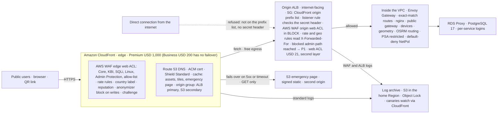
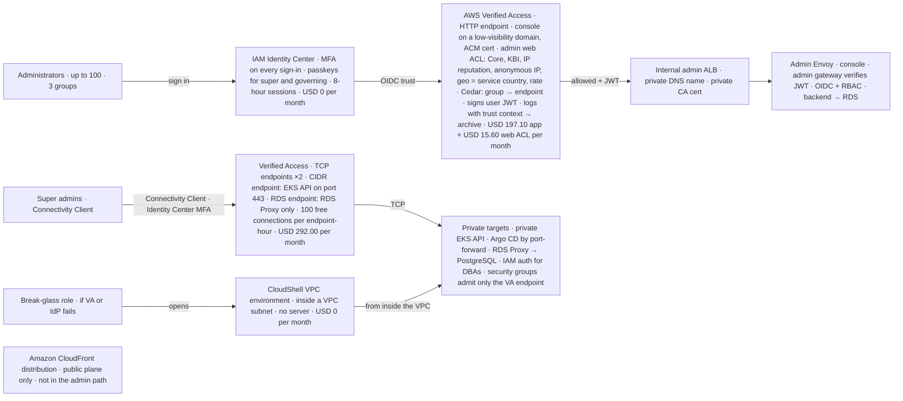
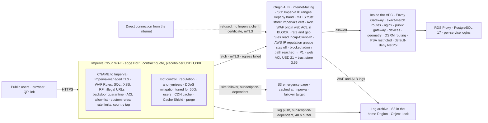

# Proposal 2 vs Proposal 3

**Proposal 2, AWS edge:** Amazon CloudFront with AWS WAF at the edge in front of the origin load balancer. **Proposal 3, existing edge:** the Imperva Cloud WAF site stays as the first filter, with AWS WAF at the origin. Both keep the same administrator path: AWS Verified Access, IAM Identity Center with mandatory MFA, an administrator web ACL and CloudShell for break-glass.

Basis: the management proposal items p2-* and p3-*, the strategy deep dives 8.1 and 8.7, the budget worksheet defaults (10 million public requests a month, 730 hours, up to 100 administrators), us-east-1 data transfer prices, and official AWS and Imperva documentation re-checked on 29 October 2026. Amounts are USD list prices or the worksheet’s planning placeholders, never vendor quotes.

Home Region us-east-1 · One administrator path in both options · Independent PDF and Markdown

General edition. Supporting evidence opens in a new tab. Internal citations and exports refer to this GitHub-deployed edition; external documentation remains unchanged.

## Contents

- [At a glance](#glance)
- [What the comparison shows](#findings)
- [Flow diagrams](#flows)
- [Public path](#public)
- [Admin path](#admin)
- [Public vs admin per option](#split)
- [AWS services vs Imperva](#services)
- [Cost](#cost)
- [Before approval](#approve)
- [Sources](#sources)

## The decision in one table

| Factor | Proposal 2 · AWS edge | Proposal 3 · Existing edge (Imperva) |
| --- | --- | --- |
| Public edge | One CloudFront distribution on a flat-rate plan, with an AWS WAF web ACL, Shield Standard and the Anti-DDoS managed rules that the Business and Premium plans bundle. [CloudFront plans](https://aws.amazon.com/cloudfront/pricing/) | The existing Imperva Cloud WAF site: CDN, DDoS mitigation, WAF rules policy, bot access control and load balancing in one service, on the tier the contract specifies (open decision B22). [Imperva datasheet](https://www.imperva.com/resources/datasheets/cloud-web-application-firewall.pdf) |
| Who sees the real visitor | CloudFront and the edge web ACL see the client address, so the AWS IP reputation and anonymous IP lists work at the edge. The origin reads the client from X-Forwarded-For. [AWS WAF IP reputation](https://docs.aws.amazon.com/waf/latest/developerguide/aws-managed-rule-groups-ip-rep.html) | Only Imperva sees the client. The origin sees Imperva addresses and reads the visitor from the Incap-Client-IP header, so the AWS reputation lists stay off at the origin and Imperva's own reputation features are used. [Imperva checklist](https://docs-cybersec.thalesgroup.com/bundle/cloud-application-security/page/onboarding/setup-checklist.htm) |
| Where the public WAF runs | Twice in AWS WAF: the edge web ACL on CloudFront (managed rules, route allow-list, rate rules, country labels) and the origin web ACL in BLOCK as a second layer. | Two engines: Imperva's WAF Rules policy, ACL and custom rules at the edge, then the AWS WAF origin web ACL in BLOCK with the same managed rule groups and route allow-list. |
| Origin lock | Security group admits only the AWS-managed CloudFront origin-facing prefix list, plus a secret origin header checked by a listener rule or the origin web ACL. The Business and Premium plans also include VPC origins and CloudFront-to-origin mTLS if a stronger lock is wanted. [restrict to ALB](https://docs.aws.amazon.com/AmazonCloudFront/latest/DeveloperGuide/restrict-access-to-load-balancer.html) | Security group admits Imperva's published IP ranges (a list the team maintains), plus mandatory mutual TLS: the ALB trust store validates the client certificate Imperva presents. [Imperva-to-origin mTLS](https://docs-cybersec.thalesgroup.com/bundle/cloud-application-security/page/certificate-mtls.htm) |
| Emergency-page failover | A CloudFront origin group fails GET requests over to the S3 page when the ALB errors or times out. Origin failover is listed only on the Premium plan (USD 1,000) or pay-as-you-go. [plan features](https://docs.aws.amazon.com/AmazonCloudFront/latest/DeveloperGuide/flat-rate-pricing-plan.html) | Imperva Load Balancing and Site Failover with health monitoring sends traffic to the S3 page. Imperva states the feature's availability depends on the subscription. [Imperva failover](https://docs-cybersec.thalesgroup.com/bundle/cloud-application-security/page/introducing/load-balancing-failover.htm) |
| Logs into the home-Region archive | CloudFront standard logs and WAF logs to S3; CloudWatch Logs ingestion is included from the Pro plan. | Imperva pushes logs to S3 or SFTP; the feature depends on the subscription, and Imperva buffers logs for at most 48 hours or 500 MB. [Imperva log integration](https://docs-cybersec.thalesgroup.com/bundle/cloud-application-security/page/settings/log-integration.htm) |
| Administrator path | Identical in both: one Verified Access HTTP endpoint for the console, two TCP endpoints for the EKS API and RDS Proxy, IAM Identity Center with mandatory MFA, an AWS WAF web ACL on the Verified Access instance, CloudShell VPC environments for break-glass. Administrators never pass through the public edge in either option. [strategy 8.7](https://talorlik.github.io/cloud-and-web-security/index.html#dd-access-rec) |  |
| Vendors and residency | AWS only. Cached public content is served from edge locations worldwide, and CloudFront's control plane is a us-east-1 exemption in the Region guardrail (decision B6). | Two vendors. Imperva points of presence and any log data held outside the approved territory are the residency-drift risk R18; the DPA and residency clauses sit in the supplier register. |
| Worksheet monthly total (defaults, corrected 29 October 2026) | USD 3,575.70 (Premium plan 1,000 + origin web ACL 21) | USD 3,579.35 (placeholder 1,000 + origin web ACL 21 + trust store 3.65) |
| Worksheet total before the correction | USD 2,754.70 (Business plan 200, origin web ACL unpriced) | USD 3,575.70 (trust store unpriced) |
| What moves the price | Plan tier against measured traffic. Flat-rate plans have no overage charges, even in a surge or an attack, and origin fetches are free. | The real Imperva quote, its traffic allowance and overage terms, and regional data transfer out of the ALB toward Imperva, which the worksheet excludes. |

[Back to contents](#top)

## Five things the totals alone do not say

**Cost · With failover priced in, the two options cost the same** The worksheet used to start Proposal 2 at the USD 200 Business plan, but that plan has no origin failover and the edge-served emergency page needs one. It now starts at Premium (USD 1,000) plus the origin web ACL, so Proposal 2 lands at USD 3,575.70, USD 3.65 below Proposal 3. The decision turns on the Imperva quote, not on the AWS lines.

**Omissions · Each option was missing a small AWS line, now priced** Proposal 2 describes an origin web ACL in BLOCK as a second layer, but the worksheet priced only the CloudFront package: about USD 21 a month at 10 million origin-bound requests. Proposal 3 makes ALB mutual TLS mandatory, and a trust store costs USD 0.005 an hour, about USD 3.65 a month. Both lines are in the worksheet since 29 October 2026.

**Traffic · Proposal 3 keeps paying AWS for every byte sent to Imperva** The ALB answers Imperva over the internet, so us-east-1 bills data transfer out at USD 0.09 per GB for the first 10 TB. CloudFront origin fetches are free and the flat-rate plan covers delivery with no overage. This is an existing cost that Proposal 2 removes and the worksheet leaves out of both options.

**Contract · Two Imperva features the design relies on are subscription-dependent** Imperva's documentation says both site failover and log integration depend on the subscription. The S3 emergency-page failover (CH-12) and the home-Region log push (B22) only exist in Proposal 3 if the contract includes them. The written scope confirmation that p3-cost asks for must name both.

**Admin · The administrator path is identical, so it does not decide anything** Both options spend USD 504.70 a month on Verified Access and the administrator web ACL, and both keep the console off the public edge. The only difference is which edge the admin plane bypasses. Public and admin planes differ sharply inside each option, which section 06 shows.

[Back to contents](#top)

## One request through each option, public and admin

Solid boxes are services the team configures. The tinted box is the public edge the option is choosing. Dashed red is a direct connection that must be refused. Dollar lines are monthly list prices or worksheet placeholders.

**Proposal 2 · public path**

Proposal 2: every public request is filtered and cached at CloudFront before an origin fetch. The origin ALB accepts only the CloudFront prefix list plus the secret header and inspects again with AWS WAF. When the ALB fails, the origin group serves the S3 emergency page for GET requests without a DNS change.

**Proposal 2 · administrator path**

Proposal 2: the console is reached through Verified Access on its own domain, never through the CloudFront distribution. Identity Center enforces MFA, the admin web ACL can use the AWS reputation lists because no proxy sits in front, and the admin gateway verifies the signed user-context token on every request.

**Proposal 3 · public path**

Proposal 3: Imperva is the only layer that sees the real visitor, so reputation, anonymizer and country checks happen there. The origin accepts only Imperva's IP ranges with a valid client certificate and inspects again with AWS WAF reading Incap-Client-IP. Failover to the S3 page and the log push to the home Region are Imperva features whose availability depends on the subscription.

**Proposal 3 · administrator path**

Proposal 3: the same administrator mechanism as Proposal 2. Administrators never pass through Imperva, so the two-vendor question does not reach the admin plane, and the admin web ACL's reputation lists work because no proxy is in front.

[Back to contents](#top)

## Public solution, layer by layer

| Layer | Proposal 2 · AWS edge | Proposal 3 · Imperva | What differs |
| --- | --- | --- | --- |
| DNS and TLS at the edge | Route 53 record to the distribution; public ACM certificate, free and auto-renewed; both included in every flat-rate plan. | DNS CNAME to the Imperva site; Imperva manages the edge certificate or a custom one is uploaded. The Route 53 hosted zone is billed as today. | Only where the certificate lives. The public domain stays separate from any corporate domain in both (CH-14). |
| DDoS absorption | Shield Standard on CloudFront and the ALB at no charge. Business and Premium add the Anti-DDoS managed rule group and an uptime SLA. Shield Advanced (USD 3,000 a month, one-year term) is not assumed and is incompatible with flat-rate plans. [Shield pricing](https://aws.amazon.com/shield/pricing/) | Imperva DDoS protection for the site, with the detection threshold tuned for 500,000 concurrent users so a real event is not treated as an attack (WAF-04). The SLA depends on the tier the contract buys (B22). Shield Standard still covers the ALB. | Proposal 3's SLA is contractual; Proposal 2's comes with the Business plan and above. |
| Application WAF | Edge web ACL with the Core, Known Bad Inputs, SQL database, Linux and Admin Protection managed groups, the positive route allow-list and rate rules. Plans allow 50 (Business) or 75 (Premium) rules including AWS managed rules. Customer rule groups and partner rules are not supported on plans. [plan guide](https://docs.aws.amazon.com/AmazonCloudFront/latest/DeveloperGuide/flat-rate-pricing-plan.html) | Imperva's default WAF Rules policy blocks SQL injection, cross-site scripting, illegal resource access and remote file inclusion; backdoor protection auto-quarantines; an ACL allow-list and custom rules carry the route list and rate criteria. [Imperva policies](https://docs-cybersec.thalesgroup.com/bundle/cloud-application-security/page/policies.htm) | Both options keep the AWS managed groups at the origin, so Proposal 3 runs two different engines and Proposal 2 runs AWS WAF twice. |
| IP reputation and anonymizers | AWS IP reputation and Anonymous IP lists on the edge web ACL, where the request source is the real client; hosting providers and anonymizers blocked on the write path only. | Imperva's reputation and client classification at the edge. The AWS lists stay off at the origin because they would only see Imperva's addresses (WAF-12). [WAF-12](https://talorlik.github.io/cloud-and-web-security/index.html#waf-12) | Same outcome, different vendor. Proposal 3 is the architecture the strategy was written against. |
| Bots and challenges | The plan's bot management covers self-identifying (common) bots; targeted bots need pay-as-you-go. JavaScript challenge is included from Business; no CAPTCHA on public pages. | Bot access control denies bad bots and allows good ones by default; a JavaScript challenge only on the position write path and only under attack (WAF-03). Imperva's Advanced Bot Protection is a separate product. | Neither option buys an advanced bot product in release one. |
| Country checks | Count rule labels by country; stricter rate limits outside the service country; no geo-block on reads; CloudFront geographic restrictions not used. | Same policy at Imperva; hard blocking, if ever wanted, only on the write path through ACL Block Countries. | No difference in policy. |
| Caching | Cache policies control the key; custom caching rules from Business; invalidations included in plans (pay-as-you-go: first 1,000 paths free, then USD 0.005 each). Writes, admin and personal data stay out of the cache. [cache key](https://docs.aws.amazon.com/AmazonCloudFront/latest/DeveloperGuide/controlling-the-cache-key.html) | Imperva cache modes (standard or custom), Cache Shield between PoPs and the origin, and manual purge. Imperva warns that caching HTML can expose personal data, so the same exclusions apply. [Imperva cache](https://docs-cybersec.thalesgroup.com/bundle/cloud-application-security/page/settings/caching-settings.htm) | Equivalent capability; Proposal 2's publishing procedure uses CloudFront invalidations, Proposal 3's uses Imperva purge. |
| Origin lock | Security group admits only the AWS-managed CloudFront origin-facing prefix list, and a secret origin header is checked. VPC origins and CloudFront-to-origin mTLS are included from Business if the team wants to take the ALB off the internet entirely. | Security group admits Imperva's published IP ranges, which the team keeps current, and the ALB trust store validates Imperva's client certificate (mandatory mTLS, gate G6). [ALB mTLS](https://docs.aws.amazon.com/elasticloadbalancing/latest/application/mutual-authentication.html) | Proposal 3 needs a maintained IP list and a trust store (USD 3.65 a month); Proposal 2's list is AWS-managed. |
| Origin WAF (second layer) | Origin web ACL in BLOCK reads the client from X-Forwarded-For; blocked admin or device-list paths reached at the origin alert at P1. In the worksheet at USD 21. | Origin web ACL in BLOCK reads Incap-Client-IP, which is stripped if it arrives from anywhere else; same P1 alert. In the worksheet at USD 21. | Same control and the same price for both options in the worksheet. |
| Emergency-page failover | Origin group: ALB primary, S3 page secondary; fails over only after a failed request to the primary and never for POST. Premium plan or pay-as-you-go. [origin failover](https://docs.aws.amazon.com/AmazonCloudFront/latest/DeveloperGuide/high_availability_origin_failover.html) | Imperva health monitoring and site failover to the S3 page, calibrated by the customer; availability depends on the subscription. | Both need a specific tier or add-on; neither is in the cheapest configuration. |
| Logs and evidence | CloudFront standard logs and WAF logs to the log-archive bucket; CloudWatch Logs ingestion included from Pro. Real-time logs are not supported on plans. | Imperva log integration pushes security and access logs to S3, SFTP or Splunk; subscription-dependent; Imperva keeps at most 48 hours or 500 MB in its repository. Near-real-time SIEM integration is a separate mode. | Proposal 3 must confirm the log feature in the contract and set the S3 push before go-live (B22). |
| Data transfer | Origin fetches from the ALB to CloudFront are free; viewer delivery is inside the plan allowance (50 TB on Business and Premium) with no overage. [pay-as-you-go](https://aws.amazon.com/cloudfront/pricing/pay-as-you-go/) | The ALB answers Imperva over the internet, so AWS bills Regional data transfer out (USD 0.09 per GB for the first 10 TB at the us-east-1 list price), and Imperva's own bandwidth allowance and overages apply. [EC2 data transfer](https://aws.amazon.com/ec2/pricing/on-demand/) | An existing metered cost that Proposal 2 removes. |
| Residency | Public content served from edge locations worldwide; CloudFront control plane in us-east-1, listed as an SCP exemption (GP-02); logs delivered to the home Region. | Imperva points of presence and logs outside the approved territory are R18; the DPA, residency commitment and security clauses must be in the supplier register. | Both need a B6 decision; Proposal 3 also needs vendor evidence. |

[Back to contents](#top)

## Administrator solution, shared by both options

| Component | Mechanism | Monthly USD | Differs between options? |
| --- | --- | ---: | --- |
| IAM Identity Center | Trust provider with MFA on every sign-in; security keys or passkeys for super and governing-organization administrators; SMS and email codes off; 8-hour sessions (HC-01, HC-07). [no extra charge](https://aws.amazon.com/iam/identity-center/faqs/) | 0.00 | No |
| Verified Access HTTP endpoint | Fronts the existing internal administrator ALB on a low-visibility domain with a public ACM certificate; group-based Cedar policies; the admin gateway verifies the signed user-context token (HC-03, HC-08, HC-09). [USD 0.27 per hour](https://aws.amazon.com/verified-access/pricing/) | 197.10 | No |
| Administrator web ACL | Attached to the Verified Access instance: Core, Known Bad Inputs, the IP reputation and anonymous IP lists, a geo match for the service country, a per-IP rate limit and an admin route allow-list (HC-04, HC-05). One ACL, ten rule entries, one million requests. | 15.60 | No. The reputation lists work in both because no proxy sits in front. |
| Verified Access TCP endpoints | Network CIDR endpoint for the EKS API on port 443 and an RDS endpoint targeting RDS Proxy, used through the Connectivity Client on Windows and macOS; 100 free connections per endpoint-hour (HC-10). [USD 0.20 per hour each](https://aws.amazon.com/verified-access/pricing/) | 292.00 | No |
| CloudShell VPC environments | Break-glass and Linux path when Verified Access or the identity provider fails; reaches the EKS API, RDS Proxy and the admin gateway from inside the VPC (HC-12). | 0.00 | No |
| Internal admin ALB, admin Envoy, console, admin gateway, backend | Existing components; private DNS name, private CA certificate; application OIDC login and role-based authorization still enforced (R01). | existing | No |
| Client VPN | Runs in parallel for two weeks with a written rollback, then the endpoint is removed (CH-15). | removed | No |
| Admin plane, priced lines | Same services, same configuration, same evidence in both options. | 504.70 | Only the edge it bypasses: CloudFront in Proposal 2, Imperva in Proposal 3. |

Cost basis: 730 hours a month and the rates on the Verified Access and AWS WAF pricing pages, as the worksheet assumes. Verified Access data processing at USD 0.02 per GB sits inside the Common usage allowance.

[Back to contents](#top)

## Inside each option, how the two planes differ

### Proposal 2 · AWS edge

| Aspect | Public plane | Admin plane |
| --- | --- | --- |
| Entry point | CloudFront distribution on the public domain, reachable by anyone. | Verified Access HTTP endpoint on a separate low-visibility domain; the console stays entirely off the distribution. |
| Identity | Anonymous visitors; device checks and PostGIS validation happen in the application. | Identity Center with mandatory MFA, Cedar group policies, then the application's own OIDC login and RBAC. |
| Web firewall | Edge web ACL in the plan (managed rules, allow-list, rate, country label, reputation) plus the origin web ACL in BLOCK. | One administrator web ACL on the Verified Access instance with reputation lists, geo match and a short admin route allow-list. |
| Location | Labelled, never blocked on reads; stricter rate limits abroad; anonymizers blocked on writes. | Allowed only from the service country, enforced at the identity provider and in Cedar, with a time-boxed exception ticket. |
| Caching and challenges | Assets, tiles and the emergency page cached; JavaScript challenge available on the write path. | Nothing cached; no challenge; every request re-evaluated against the policy. |
| Load balancer | Internet-facing origin ALB locked to the CloudFront prefix list and secret header. | Internal admin ALB with a private name and private CA certificate; security groups admit only the Verified Access endpoint. |
| Failure path | Origin group serves the S3 emergency page for GET requests. | Break-glass role opens a CloudShell VPC environment. |
| Logs and alerts | CloudFront and WAF logs; P1 when a blocked path reaches the origin; canaries through CloudFront. | Verified Access logs with trust context; P1 on policy, trust-provider or web ACL changes, MFA resets and out-of-inventory administrators; P2 on unexpected countries or hours. |
| Monthly USD (list or worksheet) | 1,000.00 Premium (200.00 Business has no failover) + origin web ACL 21.00 | 504.70 |

### Proposal 3 · Existing edge

| Aspect | Public plane | Admin plane |
| --- | --- | --- |
| Entry point | Imperva site on the public domain; Imperva terminates TLS and proxies to the origin. | Verified Access HTTP endpoint on a separate domain; administrators never pass through Imperva. |
| Identity | Anonymous visitors; application-side validation of every coordinate. | Identity Center with mandatory MFA, Cedar policies, application OIDC and RBAC. |
| Web firewall | Imperva WAF Rules policy, ACL and custom rules at the edge, then the AWS WAF origin web ACL in BLOCK. | One administrator web ACL on the Verified Access instance. |
| Who sees the visitor | Imperva only; the origin reads Incap-Client-IP and strips it from any other source. | Verified Access sees the administrator directly, so the AWS reputation lists work here. |
| Load balancer | Internet-facing origin ALB admitting Imperva IP ranges with mandatory mutual TLS (trust store). | Internal admin ALB, private name, private CA; only the Verified Access endpoint admitted. |
| Failure path | Imperva site failover to the S3 emergency page (subscription-dependent). | Break-glass role opens CloudShell. |
| Logs and alerts | Imperva push to S3 (subscription-dependent) plus WAF and ALB logs; Imperva alerts are P2 and P1 during an event (AL-10). | Verified Access logs with trust context; same P1 and P2 rules as Proposal 2. |
| Vendors | Two: Imperva and AWS, coordinated in one response process and one runbook per provider. | One: AWS. |
| Monthly USD (list or worksheet) | Imperva quote (placeholder 1,000.00) + origin web ACL 21.00 + trust store 3.65 + Regional data transfer (existing, excluded from the worksheet) | 504.70 |

[Back to contents](#top)

## Each AWS service against what Imperva includes

"Included" means Imperva documents the capability as part of Cloud WAF. "Subscription-dependent" means Imperva's documentation says availability depends on the plan, so the contract must name it. "Not included" means AWS provides it in both options or Imperva has no equivalent in the path.

| AWS service or feature | Role in Proposal 2 | Role in Proposal 3 | Imperva includes it? | Cost effect |
| --- | --- | --- | --- | --- |
| Amazon CloudFront (CDN, TLS, caching, invalidations) | Public entry and cache; one distribution on a flat-rate plan. | Not used. Imperva's CDN caches, with Cache Shield and purge. | Included | Proposal 2: USD 200 (Business) or USD 1,000 (Premium), or pay-as-you-go. Proposal 3: inside the Imperva contract; no AWS line. |
| AWS WAF web ACL at the edge | On CloudFront: managed groups, allow-list, rate rules, country labels. Mandatory on a plan; counts against 50 or 75 rules. | None. Imperva WAF Rules policy, ACL and custom rules do this at the edge. | Included | Proposal 2: bundled in the plan (pay-as-you-go would be USD 5 + rules + USD 0.60 per million). Proposal 3: contract. |
| AWS WAF web ACL at the origin ALB | Second layer in BLOCK; reads X-Forwarded-For. | Second layer in BLOCK; reads Incap-Client-IP. | Not applicable | Both: USD 5 + USD 10 for ten rule entries + USD 0.60 per million origin-bound requests, about USD 21 at the worksheet volume. Priced for both options in the worksheet. |
| AWS managed rule groups (Core, Known Bad Inputs, SQL database, Linux, Admin Protection) | At the edge and at the origin. | At the origin only. | Partly (Imperva's policy covers SQLi, XSS, RFI and illegal resource access; the Java deserialization and Log4j rules in Known Bad Inputs are AWS-specific.) | USD 1 per managed group per web ACL, inside the ten-entry assumption. No change between options. |
| AWS WAF IP reputation and Anonymous IP lists | On the edge web ACL, effective. | Off on the public plane; on the admin web ACL only. | Included (Imperva reputation and client classification.) | No price difference; two managed groups either way. |
| AWS WAF Bot Control | Common bots are part of Business and Premium; targeted bots are not supported on plans. | Not used; Imperva bot access control. | Included (Basic bot control. Advanced Bot Protection is a separate Imperva product.) | USD 0 in both as designed. Targeted Bot Control would be USD 10 a month plus USD 10 per million on pay-as-you-go. [WAF pricing](https://aws.amazon.com/waf/pricing/) |
| AWS WAF JavaScript challenge and CAPTCHA | JS challenge in Business and Premium; CAPTCHA responses in rules included in plans. | Not used; Imperva challenge on the write path under attack. | Included | Pay-as-you-go would bill USD 0.40 per million challenge responses; nothing inside a plan or inside Imperva. |
| AWS Shield Standard | CloudFront and the ALB. | The ALB behind Imperva. | Included (Imperva DDoS mitigation for the site; threshold and SLA per tier.) | USD 0 in both. |
| AWS Shield Advanced | Not assumed; not allowed on a flat-rate distribution. | Not assumed. | Depends on tier (Imperva's DDoS SLA is the counterpart (B22).) | USD 3,000 a month with a one-year term if ever bought; neither option includes it. |
| AWS WAF Anti-DDoS managed rule group | Included from Business ("Advanced DDoS protection"). | Not used. | Included (Layer 7 DDoS mitigation is Imperva's core service.) | Pay-as-you-go would be USD 20 per web ACL plus USD 0.15 per million. |
| CloudFront origin group (origin failover) | ALB primary, S3 secondary, GET only. | Not used; Imperva Load Balancing and Site Failover with health monitoring. | Subscription-dependent | Proposal 2: Premium plan (USD 1,000) or pay-as-you-go, where failover has no separate charge. Proposal 3: confirm it is in the contract. |
| Amazon S3 (signed static emergency page) | Secondary origin behind the origin group. | Failover target cached at Imperva. | Not applicable | Negligible; Business includes 1 TB of S3 storage credits. |
| CloudFront origin-facing managed prefix list and secret origin header | Locks the ALB to CloudFront. | Replaced by Imperva's published IP ranges, maintained by the team. | Partly (Imperva publishes its IP ranges; nothing updates the security group automatically.) | USD 0 in both; Proposal 3 carries an operational task. |
| CloudFront VPC origins and CloudFront-to-origin mTLS | Available from Business if the ALB should leave the internet entirely; not required by the proposal text. | Not applicable. | Included (Imperva-to-origin mTLS is the Proposal 3 equivalent.) | Inside the plan. A design choice, not a cost line. |
| ALB mutual TLS trust store | Not needed. | Mandatory: validates Imperva's client certificate (G6). | Included (Imperva uploads and presents the client certificate.) | USD 0.005 per trust-store hour, about USD 3.65 a month; in the worksheet. [ELB pricing](https://aws.amazon.com/elasticloadbalancing/pricing/) |
| AWS WAF forwarded-IP configuration | Origin rules read X-Forwarded-For. | Origin rules read Incap-Client-IP; header stripped from any other source. | Included (Imperva inserts the header by default.) | USD 0. [forwarded IP](https://docs.aws.amazon.com/waf/latest/developerguide/waf-rule-statement-forwarded-ip-address.html) |
| Amazon Route 53 | Public DNS for the distribution, included in the plan. | CNAME to Imperva from the existing hosted zone. | Separate product (Imperva DNS Protection is a different service, not assumed.) | Hosted zone and queries are existing costs in both. |
| AWS Certificate Manager | Public certificate on CloudFront and on the origin ALB. | Certificate on the origin ALB; Imperva handles the edge certificate. | Included | USD 0 in both. |
| CloudFront standard logs and WAF logs to S3 | Delivered to the home-Region archive; CloudWatch Logs ingestion included from Pro. | WAF and ALB logs as usual; edge logs come from Imperva's push. | Subscription-dependent (Imperva log integration to S3, SFTP or Splunk; 48-hour buffer at Imperva.) | S3 storage sits in the Common allowance for both. Proposal 3 must confirm the log feature in the contract. |
| CloudWatch Synthetics canaries | Watch the site and emergency page through CloudFront. | Watch them through Imperva. | Not applicable | Same in both; inside the Common monitoring allowance. |
| AWS Verified Access (one HTTP app, two TCP endpoints) | Administrator path. | Administrator path. | Not included (Imperva plays no part in administrator access.) | USD 489.10 a month in both. |
| IAM Identity Center and CloudShell VPC environments | Trust provider and break-glass. | Same. | Not included | USD 0 in both. |
| AWS WAF web ACL on the Verified Access instance | Administrator web ACL. | Same. | Not included | USD 15.60 a month in both. |
| Regional data transfer out (ALB to the internet) | Not billed: origin fetches to CloudFront are free, delivery is inside the plan. | Billed for every byte the ALB sends to Imperva, at USD 0.09 per GB for the first 10 TB (us-east-1 list price). | Partly (Imperva's bandwidth allowance covers its own delivery, not the AWS egress toward it.) | Proposal 3 continues an existing metered cost, reduced only by what Imperva caches. Excluded from the worksheet in both, and the worksheet now says so. |
| Network Firewall, VPC endpoints, EKS, RDS Proxy, KMS, Secrets Manager, GuardDuty, Security Hub, Inspector, Config, Backup | Identical inside the VPC and in Common. | Identical. | Not included | No difference; Common allowance or existing hosting. |

[Back to contents](#top)

## Where the money goes

### Worksheet defaults, side by side (corrected 29 October 2026)

| Line | Proposal 2 | Proposal 3 | Basis |
| --- | ---: | ---: | --- |
| Common (detection, logs and backups, operations, licences) | 2,050.00 | 2,050.00 | Planning allowances, identical. |
| Verified Access (one web application, two TCP endpoints) | 489.10 | 489.10 | 730 hours at USD 0.27 and 2 × USD 0.20. |
| Administrator web ACL | 15.60 | 15.60 | USD 5 + 10 rule entries + 1 million requests. |
| Public edge | 1,000.00 | 1,000.00 | CloudFront Premium plan example, the lowest flat-rate plan that lists origin failover, versus the Imperva placeholder, which is not a quote. |
| AWS WAF at the origin | 21.00 | 21.00 | USD 15 + USD 0.60 × 10 million, counting every public request as origin-bound. |
| ALB mutual TLS trust store | — | 3.65 | 730 hours × USD 0.005; mandatory in Proposal 3 only. |
| Monthly | 3,575.70 | 3,579.35 | USD 3.65 apart. The Imperva placeholder decides the rest. |
| Yearly recurring | 42,908.40 | 42,952.20 | Monthly × 12. |
| One-time (shared setup 8,000 + option setup 3,000) | 11,000.00 | 11,000.00 | Both options assume 30 hours of implementation. |
| First year | 53,908.40 | 53,952.20 | Yearly plus one-time. |

### What the correction changed

| Line | Proposal 2 | Proposal 3 | Why |
| --- | ---: | ---: | --- |
| Worksheet monthly before 29 October 2026 | 2,754.70 | 3,575.70 | Business plan at USD 200 and no origin web ACL for Proposal 2; no trust store for Proposal 3. |
| Edge-served failover needs Premium | + 800.00 | — | Origin failover is listed only on Premium (USD 1,000); Business (USD 200) lacks it. p2-cost now says so. |
| Origin web ACL in BLOCK | + 21.00 | — | p2-edge keeps the origin web ACL as a second layer; the worksheet now prices it. |
| ALB mutual TLS trust store | — | + 3.65 | p3-origin makes mTLS mandatory; USD 0.005 per hour per trust store, now a worksheet line. |
| Corrected monthly (the current default) | 3,575.70 | 3,579.35 | USD 3.65 apart, as above. |
| Corrected first year | 53,908.40 | 53,952.20 | Both with USD 11,000 one-time. |
| Pay-as-you-go alternative for Proposal 2 at the worksheet volume | 2,596.70 | — | 10 million requests and 1 TB fall inside CloudFront's always-free tier, so the edge costs only two web ACLs (USD 42). Origin failover has no separate charge on pay-as-you-go, but the plan's Anti-DDoS rules, uptime SLA and no-overage guarantee are not part of it. |

### How the public edge scales with traffic

Public-edge lines only, excluding Common, the admin plane and the Imperva quote. Volumes are illustrations, not forecasts: data assumes an average of 100 KB per request. Proposal 2 pay-as-you-go uses the Europe price class and charges the first-10 TB rate for all volume beyond the free 1 TB, an upper bound. Proposal 3 uses the us-east-1 data transfer tiers, and Imperva caching reduces origin-bound volume.

| Requests and data per month | P2 pay-as-you-go | P2 Business (no failover) | P2 Premium | P3 AWS side | P3 with USD 1,000 placeholder |
| --- | ---: | ---: | ---: | ---: | ---: |
| 10 million · 1 TB (worksheet default) | 21.00 | 200.00 | 1,000.00 | 114.65 | 1,114.65 |
| 50 million · 5 TB | 433.00 | 200.00 | 1,000.00 | 498.65 | 1,498.65 |
| 125 million · 12.5 TB (Business allowance) | 1,205.50 | 200.00 | 1,000.00 | 1,206.15 | 2,206.15 |
| 300 million · 30 TB (event month) | 3,008.00 | above allowance | 1,000.00 | 2,798.65 | 3,798.65 |

P2 pay-as-you-go = CloudFront data transfer (USD 0.085 per GB after 1 TB free) + HTTPS requests (USD 0.012 per 10,000 after 10 million free) + edge web ACL (USD 15 + USD 0.60 per million). P3 AWS side = origin web ACL (USD 15 + USD 0.60 per million) + Regional data transfer out (USD 0.09 per GB first 10 TB, USD 0.085 next 40 TB) + trust store (USD 3.65). Add the origin web ACL to every P2 column for a like-for-like total. The flat-rate allowances are not hard limits, but AWS notifies at 50, 80 and 100 percent and the plan is sized for that baseline; blocked requests never count. Premium can be configured up to 6 billion requests and 600 TB for a new flat rate.

### What the worksheet leaves out, and which way each item leans

| Item | Proposal 2 | Proposal 3 | Leans toward |
| --- | --- | --- | --- |
| Regional data transfer out from the ALB | Removed: origin fetches to CloudFront are free. | Continues: every byte to Imperva is billed by the Region; the worksheet now names this exclusion. | Proposal 2 |
| Surge and attack months | No overage on a flat-rate plan; blocked requests do not count. | Imperva traffic allowances and overage terms apply; AWS egress is metered. | Proposal 2 |
| Migration | Build and test a new edge, origin lock, caching and failover; run the origin-bypass and cache-update tests. | No migration; the existing site stays and the team adds mTLS, the origin web ACL and the log push. | Proposal 3 |
| Incident support and DDoS SLA | AWS uptime SLA from Business; Shield Response Team only with Shield Advanced and a Business or Enterprise support plan. | Contractual DDoS SLA and 24/7 Imperva security operations on the right tier. | Proposal 3, if the contract has it |
| Site failover and log push | Failover on Premium or pay-as-you-go; logs from Pro. | Both subscription-dependent at Imperva; must be in the written scope. | Unknown until the quote |
| Operational coordination | One vendor; the team tunes cache and invalidation rules and keeps the origin header secret. | Two vendors; WAF rules, log delivery, residency evidence and incidents coordinated across AWS and Imperva; the IP range list maintained by hand. | Proposal 2 |
| Residency evidence | Edge locations worldwide and a us-east-1 control plane need a B6 statement. | Imperva DPA, residency commitment and log location need supplier evidence (R18). | Neither; both need a steering-committee decision |
| Shield Advanced, targeted Bot Control, fraud control | Not assumed; not available on a flat-rate plan. | Not assumed. | Neither |

[Back to contents](#top)

## What each option must prove, and what the quote must say

**Proposal 2 · Approve only after** A traffic model with normal and emergency forecasts; an origin-bypass test proving a direct connection to the ALB is refused (G6); a cache-update test against the publishing procedure; the surge drill with edge failover and an emergency guidance update (G11); a residency review accepting worldwide edge delivery; and a decision between Premium and pay-as-you-go once the failover requirement is priced.

**Proposal 3 · Approve only after** A written Imperva price and scope confirmation naming the tier, bot management, the DDoS SLA, site failover, log integration to S3, traffic allowances and overage terms; mandatory origin mutual TLS tested (G6); the log push to the home Region confirmed before go-live (B22); the DPA and residency clauses in the supplier register; and the comparison of that total plus the avoided migration against Proposal 2.

**Both · Unchanged either way** Verified Access with Identity Center MFA for administrators, the origin web ACL in BLOCK after a clean seven-day COUNT period, exact-match public routes, the signed S3 emergency page, Kyverno in Enforce, and the twelve go-live gates with evidence.

> If the Imperva quote lands near the USD 1,000 placeholder, the two options cost the same on the AWS lines and the choice is about operations and contract value: one vendor with no overage and no migration risk on AWS egress, against an existing edge with a contractual DDoS SLA and no migration. If the quote is materially higher, Proposal 2 on Premium is cheaper and also removes the metered egress. If it is materially lower, Proposal 3 wins on price but still needs failover and log push in the contract.

[Back to contents](#top)

## Documents this comparison relies on

### Project documents

1. Management proposal, Proposal 2 items p2-fit to p2-work and Proposal 3 items p3-fit to p3-work, and the budget worksheet: [management proposal](https://talorlik.github.io/cloud-and-web-security/proposal/index.html)
2. Security strategy 8.1 WAF rules (WAF-01 to WAF-14), 8.5 admin hostname, 8.7 admin access (HC-01 to HC-12), decisions B6 and B22, risks R05, R07 and R18, changes CH-12 and CH-15, gates G6 and G11: [security strategy](https://talorlik.github.io/cloud-and-web-security/index.html)

### AWS, checked 29 October 2026

1. CloudFront pricing, flat-rate plans: [aws.amazon.com/cloudfront/pricing/](https://aws.amazon.com/cloudfront/pricing/)
2. CloudFront flat-rate pricing plan guide, features by tier, usage allowances, unsupported features: [docs.aws.amazon.com/AmazonCloudFront/latest/DeveloperGuide/flat-rate-pricing-plan.html](https://docs.aws.amazon.com/AmazonCloudFront/latest/DeveloperGuide/flat-rate-pricing-plan.html)
3. CloudFront pay-as-you-go pricing: [aws.amazon.com/cloudfront/pricing/pay-as-you-go/](https://aws.amazon.com/cloudfront/pricing/pay-as-you-go/)
4. AWS WAF pricing: [aws.amazon.com/waf/pricing/](https://aws.amazon.com/waf/pricing/)
5. AWS Verified Access pricing: [aws.amazon.com/verified-access/pricing/](https://aws.amazon.com/verified-access/pricing/)
6. AWS Shield pricing: [aws.amazon.com/shield/pricing/](https://aws.amazon.com/shield/pricing/)
7. Elastic Load Balancing pricing, including the mutual TLS trust-store rate: [aws.amazon.com/elasticloadbalancing/pricing/](https://aws.amazon.com/elasticloadbalancing/pricing/)
8. EC2 on-demand pricing, data transfer out to the internet: [aws.amazon.com/ec2/pricing/on-demand/](https://aws.amazon.com/ec2/pricing/on-demand/)
9. CloudFront origin failover: [high_availability_origin_failover.html](https://docs.aws.amazon.com/AmazonCloudFront/latest/DeveloperGuide/high_availability_origin_failover.html)
10. Restricting access to an Application Load Balancer origin: [restrict-access-to-load-balancer.html](https://docs.aws.amazon.com/AmazonCloudFront/latest/DeveloperGuide/restrict-access-to-load-balancer.html)
11. CloudFront VPC origins: [private-content-vpc-origins.html](https://docs.aws.amazon.com/AmazonCloudFront/latest/DeveloperGuide/private-content-vpc-origins.html)
12. AWS WAF IP reputation rule groups: [aws-managed-rule-groups-ip-rep.html](https://docs.aws.amazon.com/waf/latest/developerguide/aws-managed-rule-groups-ip-rep.html)
13. AWS WAF forwarded IP address: [waf-rule-statement-forwarded-ip-address.html](https://docs.aws.amazon.com/waf/latest/developerguide/waf-rule-statement-forwarded-ip-address.html)
14. Application Load Balancer mutual TLS: [mutual-authentication.html](https://docs.aws.amazon.com/elasticloadbalancing/latest/application/mutual-authentication.html)
15. IAM Identity Center FAQ (no additional charge): [aws.amazon.com/iam/identity-center/faqs/](https://aws.amazon.com/iam/identity-center/faqs/)

### Imperva, checked 29 October 2026

1. Imperva Cloud WAF datasheet (CDN, DDoS Protection, Advanced Bot Protection, API Security and Load Balancing as a suite): [cloud-web-application-firewall.pdf](https://www.imperva.com/resources/datasheets/cloud-web-application-firewall.pdf)
2. Create and manage policies (WAF Rules, ACL): [policies.htm](https://docs-cybersec.thalesgroup.com/bundle/cloud-application-security/page/policies.htm)
3. WAF settings and security settings: [waf-settings.htm](https://docs-cybersec.thalesgroup.com/bundle/cloud-application-security/page/settings/waf-settings.htm), [security-settings.htm](https://docs-cybersec.thalesgroup.com/bundle/cloud-application-security/page/settings/security-settings.htm)
4. Rules (rate criteria): [rules.htm](https://docs.imperva.com/bundle/cloud-application-security/page/rules/rules.htm)
5. Cache settings and Cache Shield: [caching-settings.htm](https://docs-cybersec.thalesgroup.com/bundle/cloud-application-security/page/settings/caching-settings.htm)
6. Load Balancing and Failover (availability depends on subscription): [load-balancing-failover.htm](https://docs-cybersec.thalesgroup.com/bundle/cloud-application-security/page/introducing/load-balancing-failover.htm)
7. Cloud WAF Log Integration (availability depends on subscription; push to SFTP, Amazon S3 or Splunk; 48-hour repository): [log-integration.htm](https://docs-cybersec.thalesgroup.com/bundle/cloud-application-security/page/settings/log-integration.htm)
8. Imperva-to-Origin mTLS: [certificate-mtls.htm](https://docs-cybersec.thalesgroup.com/bundle/cloud-application-security/page/certificate-mtls.htm)
9. Customer setup checklist (Incap-Client-IP and X-Forwarded-For headers): [setup-checklist.htm](https://docs-cybersec.thalesgroup.com/bundle/cloud-application-security/page/onboarding/setup-checklist.htm)

Every amount is a list price in US dollars at the Region shown on the pricing page, or a worksheet planning placeholder. None is a vendor quote, a capacity model or a promise of savings. Confirm us-east-1 rates, Verified Access availability and the Imperva contract before approval.

[Back to contents](#top)

