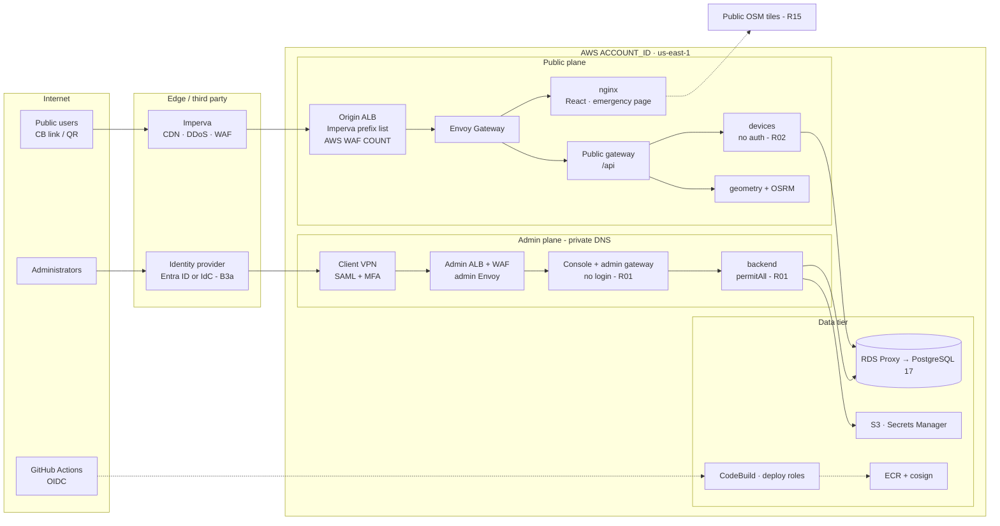

# Security strategy for the alerting system website and its AWS account

Security strategy · Version 1.0 · 2026-10-21 · Public edition · identifiers redacted

The plan to make the national population-guidance system trustworthy during an evacuation: always reachable, giving guidance no one can tamper with, and protecting location and medical data. It is built on CIS Controls v8.1, CIS Benchmarks, ISO/IEC 27001:2022 and the AWS Well-Architected Security Pillar.

- **500,000** concurrent public users at peak
- **1 of 5** Terraform layers applied (account_infra)
- **4** critical application findings open (F5, C21)
- **12** go-live security gates defined

**Frameworks applied:** CIS Controls v8.1 · IG2 → IG3 · CIS AWS Foundations 7.1.0 · CIS EKS 2.0.0 · CIS Ubuntu L1 · CIS PostgreSQL 17 · CIS NGINX · ISO/IEC 27001:2022 + Amd 1 · AWS WA Security Pillar · OWASP ASVS 5.0 L2 · GDPR & ISO/IEC 27701:2025

## Contents

1. [Executive summary](#summary)
    - [Ten moves that matter most](#sum-top-actions)
2. [Scope and system context](#scope)
    - [Trust zones and data flows](#scope-diagram)
    - [Assets and data classification](#scope-assets)
    - [Shared responsibility](#scope-responsibility)
3. [Framework baseline](#frameworks)
    - [Version gaps you need to manage](#fw-gaps)
4. [Threat model](#threats)
    - [STRIDE view of the critical flows](#threat-stride)
5. [Risk register](#risks)
6. [Strategic principles](#principles)
7. [Control domains](#domains)
    - [7.1 Security foundations and governance](#d-foundations-h)
    - [7.2 Identity and access management](#d-iam-h)
    - [7.3 Detection and logging](#d-detect-h)
    - [7.4 Infrastructure protection](#d-infra-h)
    - [7.5 Data protection and privacy](#d-data-h)
    - [7.6 Application security](#d-app-h)
    - [7.7 Software supply chain and change](#d-supply-h)
    - [7.8 Incident response and resilience](#d-ir-h)
    - [7.9 People and operations](#d-people-h)
8. [Required changes to the current setup](#changes)
9. [Control mapping matrix](#matrix)
10. [Roadmap and go-live gates](#roadmap)
    - [10.1 Phases](#phases)
    - [10.2 Go-live security gates](#gates)
11. [Metrics and reporting](#metrics)
12. [Decisions needed](#decisions)
13. [References](#references)

---

## 01 · Executive summary

**The platform is well designed, but the application is not yet safe to expose**

The AWS platform design is unusually mature for this stage: GitHub OIDC, SHA-pinned actions, signed images, a private EKS cluster, an Imperva edge and an admin plane behind a VPN with MFA. The application inside it is not ready. It has no working authentication or authorization, and its device endpoints are open to the internet. This strategy closes that gap first, then removes the structural risks that sit in the current decisions.

### Ten moves that matter most

1. **Close the public device read surface now, at the platform.** Change the public HTTPRoutes and Imperva rules so only exact public paths and methods (position post, geo lookups) pass. This needs no change to `app/`. See [CH-01](#ch-01).
2. **Make admin login and authorization (F5, C21) a hard go-live gate.** Use OIDC against the chosen identity provider, with per-authority RBAC, and remove the seed `admin/admin` account and `NoOpPasswordEncoder`. See [SC-05](#sc-05).
3. **Decide the identity provider (B3a).** The recommendation is client Entra ID with phishing-resistant MFA, federated to Client VPN, IAM Identity Center, Argo CD and the console. See [B3a](#dec-b3a).
4. **Strip debug and outdated parts from images.** Remove JDWP on 8787, run as non-root, replace `openjdk:17.0.1` and turn off Swagger in prd. See [CH-06](#ch-06).
5. **Move logs to immutable storage with tiered retention, replacing 30-days-and-delete (D35).** Keep security logs at least 1 year, in an Object Lock archive. See [CH-03](#ch-03).
6. **Limit how long location data is kept (D34) and drop device emails (C15).** Permanent retention of personal location data is the largest legal and breach exposure. See [CH-04](#ch-04).
7. **Split prd into its own account, inside AWS Organizations (B25).** Add log-archive and security-tooling accounts and SCP guardrails. See [CH-02](#ch-02).
8. **Switch WAF to BLOCK and Kyverno to Enforce with evidence, before go-live** (9.1.7, 9.1.5). Make Imperva origin mTLS mandatory. See [SC-11](#sc-11).
9. **De-privilege the database user (D47).** Split owner/migration and runtime roles, and replace `ddl-auto: update` with versioned migrations. See [CH-05](#ch-05).
10. **Commission an independent penetration test (B11)** after the Phase 12 fixes and before go-live. Retest, then repeat at least yearly. See [B11](#dec-b11).

**Posture by Well-Architected area (today)**

| Area | Score |
| --- | --- |
| Security foundations | 45% |
| Identity & access | 30% |
| Detection | 65% |
| Infrastructure protection | 60% |
| Data protection | 45% |
| Incident response | 20% |
| Application security | 15% |

This is a judgment score, not a measurement. It weighs each area's live controls against its design. Designed but unapplied controls count for half. Re-score at each phase gate.

> **Bottom line**
>
> Go-live must wait for 12 gates ([section 10.2](#gates)). Seven can be done by the platform team alone. Five depend on the application team or the client.

[Back to contents](#pdf-contents)

---

## 02 · Scope and system context

**What we are protecting, and from whom it is reachable**

This strategy covers both faces of the system (the public navigation site and the admin console), the AWS account ACCOUNT_ID in us-east-1 with its `dev` and `prd` environments, the delivery chain (GitHub, CodeBuild, ECR, Argo CD) and the third parties in the path (Imperva, the identity provider).

### Trust zones and data flows

_Blue lines show public traffic, amber shows admin traffic, dashed shows delivery. Red markers show where the top risks sit ([section 05](#risks)). The dev VPC (DEV_VPC_CIDR) has the same shape in the same account today._

### Assets and data classification

| Asset | Class | Why it matters | Today |
| --- | --- | --- | --- |
| **Guidance content**  assembly areas, routes, instructions, emergency page | Safety-critical integrity | If an attacker changes it, people are sent the wrong way during an evacuation. This is the top impact in the whole system. | Console has no login (F5) |
| **Device location samples** | Restricted · personal | Continuous tracks of up to 500,000 people are personal data under privacy law (GDPR and equivalent laws). They show where people live, work and shelter. | Kept permanently (D34) |
| **Medical-need flag and counts** | Restricted · sensitive | Health-related. Must stay as counts per area and never be tied to a device. | Counts per area |
| **Device email** (`ds_account`) | Restricted · personal | An identifier that links location tracks to a person. It goes against the stated policy (C15). | Stored; can be looked up from the internet |
| **Occupancy and movement map** | Confidential · operational | Shows where crowds are during an emergency. Its integrity drives decisions by Police, Fire and EMS. | No rate limiting, open check-in |
| **Admin accounts and credentials** | Secret | Whoever holds them controls the guidance. | Plain text, seed `admin/admin` |
| **Platform credentials and keys**  KMS, cosign, Secrets Manager, deployment roles | Secret | Control of the supply chain and the data. | Designed well |
| **Authority polygons, photos, logs** | Internal | Logs are also evidence and can contain IP addresses and locations. | Logs 30 days (D35) |

### Shared responsibility

#### Platform operator — AWS account, network, EKS, data services, CI/CD, detection, NOC

Owns the platform controls in this strategy. Never edits `app/`, but can limit what reaches it through routes, WAF and policy.

#### Application team — Code in app/, its authentication, authorization and APIs

Owns Phase 12 fixes (F5 = 12.1.5). Each fix starts only after the developer approves in writing.

#### Client & partners — Steering Committee, CPA, Imperva, IdP owner, AWS

The Steering Committee owns risk acceptance and residency (B6). Civil Protection Authority (CPA) owns the Cell Broadcast. Imperva owns the edge, and AWS owns security of the cloud.

[Back to contents](#pdf-contents)

---

## 03 · Framework baseline

**How the four frameworks fit together**

Each framework does a different job. ISO 27001 is the management system that owns risk and evidence. The CIS Controls set the order of work. The CIS Benchmarks define the exact configuration. The Well-Architected Security Pillar provides the AWS-native design patterns. Every strategic control in [section 09](#matrix) maps to all four.

#### Management system — ISO/IEC 27001:2022 (+ Amd 1:2024)

Clauses 4 to 10 define the ISMS: scope, risk assessment and treatment, a Statement of Applicability, internal audit and management review. Annex A has 93 controls in four themes: organizational (37), people (8), physical (14) and technological (34) ([Modulos summary of Annex A](https://docs.modulos.ai/frameworks/iso-27001/annex-a)). Amendment 1 (2024) adds climate-change considerations to the context clauses ([ISO](https://www.iso.org/standard/27001)). Physical controls A.7 are mostly inherited from AWS and Imperva, and are covered through supplier evidence.

#### Prioritization — CIS Critical Security Controls v8.1

18 controls, from asset inventory to penetration testing ([CIS](https://www.cisecurity.org/controls/cis-controls-list)). They are grouped into Implementation Groups IG1 to IG3. IG3 is meant for organizations handling sensitive data or critical infrastructure ([Cisco CIS v8.1 brief](https://www.cisco.com/c/en/us/products/collateral/security/cis-controls-sb.html)). **Target:** all IG2 safeguards at go-live, then the IG3 safeguards that apply to this system (application-layer filtering, RBAC, code-level checks, application pen testing) within 12 months.

#### Configuration — CIS Benchmarks

Current versions: AWS Foundations 7.1.0 ([CIS AWS](https://www.cisecurity.org/benchmark/amazon_web_services)), EKS 2.0.0, which covers Kubernetes 1.34 and 1.35 ([CIS June 2026 update](https://www.cisecurity.org/insights/blog/cis-benchmarks-june-2026-update)), PostgreSQL 17 1.1.0 ([CIS PostgreSQL](https://www.cisecurity.org/benchmark/postgresql)), and NGINX 3.1.0 ([CIS NGINX](https://www.cisecurity.org/benchmark/nginx)). Add the CIS Ubuntu benchmark (nodes, already L1) and the CIS Docker benchmark (images).

#### AWS design — Well-Architected Security Pillar

Seven best-practice areas: security foundations, identity and access management, detection, infrastructure protection, data protection, incident response and application security ([AWS Well-Architected](https://docs.aws.amazon.com/wellarchitected/latest/framework/a-security.html)). Its design principles include a strong identity foundation, traceability, security at all layers and keeping people away from data ([Security Pillar](https://docs.aws.amazon.com/wellarchitected/latest/security-pillar/security.html)). Section 07 is organized by these seven areas.

### Version gaps you need to manage

> **Security Hub automates CIS AWS Foundations only up to v5.0.0**
>
> Security Hub CSPM supports CIS AWS Foundations v5.0.0, 3.0.0, 1.4.0 and 1.2.0, and does not cover every requirement automatically ([AWS Security Hub documentation](https://docs.aws.amazon.com/securityhub/latest/userguide/cis-aws-foundations-benchmark.html)). CIS has since published v7.0.0 and v7.1.0 ([CIS April 2026 update](https://www.cisecurity.org/insights/blog/cis-benchmarks-april-2026-update)). **Strategy:** enable the v5.0.0 standard in Security Hub as the automated baseline. Cover the manual and newer v7.1.0 items with AWS Config custom rules or a quarterly CIS-CAT/Prowler run, and record the results as ISMS evidence.

> **EKS 1.36 is newer than the CIS EKS benchmark**
>
> CIS EKS 2.0.0 targets Kubernetes 1.34 and 1.35. Apply it to the 1.36 cluster, record any differences as justified deviations in the Statement of Applicability, and re-baseline when CIS publishes a release that covers 1.36.

> **Privacy law is a binding overlay, not optional**
>
> Use the EU GDPR as the global privacy baseline. Most modern privacy laws follow its model. Article 5 requires data minimisation, storage limitation, and integrity and confidentiality of personal data ([GDPR Article 5](https://www.gdpr.org/regulation/article-5.html)). Under Article 35, a Data Protection Impact Assessment is mandatory for large-scale systematic monitoring, and supervisory authorities list tracking people's location as a trigger ([EDPB-published DPIA guidance](https://www.edpb.europa.eu/system/files/decisions/ie_dpc_data-protection-impact-assessment.pdf)). Continuous location samples from up to 500,000 devices clearly meet that bar. Run privacy management with ISO/IEC 27701:2025, which is now a stand-alone privacy information management system standard ([ISO/IEC 27701:2025](https://cdn.standards.iteh.ai/samples/iso/iso-iec-27701-2025/999f0b4e27d84804be12758c821cc34e/iso-iec-27701-2025.pdf)). Map the local law of each jurisdiction you operate in onto this baseline, and appoint a DPO.

[Back to contents](#pdf-contents)

---

## 04 · Threat model

**Who attacks an emergency system, and when**

The attack that matters most comes during a real event or drill, when the site's value and public attention are at their peak. Plan for availability and integrity attacks on the day, and for quiet data theft in between.

#### TA-1 · State-sponsored — Disruption or disinformation during a real event

DDoS timed to an alert, tampering with guidance content, a fake guidance site, and pre-positioned access through the supply chain or admin accounts. Targets integrity and availability.

#### TA-2 · Hacktivists — Defacement and volumetric DDoS

Opportunistic. Uses public findings like Swagger UI, open device endpoints and default credentials. Will publish any data leak.

#### TA-3 · Data harvesters — Bulk extraction of location and contact data

Enumerates `GET /device?all=true` and email lookups. Re-identification and resale. Highest legal impact under GDPR-style privacy law.

#### TA-4 · Insider or compromised partner — Misuse of legitimate access

Wide authority user base (Police, Fire, EMS, local authorities, CPA). Shared or leftover accounts, and social engineering of the NOC to scale capacity down.

#### TA-5 · Physical / local — QR sticker replacement on signs

A cheap way to send people to a lookalike site. It bypasses every cloud control, so it needs physical and domain-trust countermeasures.

#### TA-6 · Abuse of public flows — Fake check-ins and location floods

Bots post fake arrivals or medical flags to distort occupancy, which misleads first responders. There is no rate limiting today (C14).

### STRIDE view of the critical flows

| Flow | Main threats | Primary controls |
| --- | --- | --- |
| Public user → Imperva → origin → devices/geo | DoS, Tampering (fake check-ins), Information disclosure (device enumeration) | [SC-11](#sc-11), [SC-12](#sc-12), [SC-13](#sc-13), [SC-26](#sc-26), [SC-33](#sc-33) |
| Administrator → VPN → console → backend | Spoofing (no app login), Elevation (no RBAC), Repudiation (no per-user audit) | [SC-04](#sc-04), [SC-05](#sc-05), [SC-08](#sc-08) |
| Service → service (plain HTTP) | Spoofing, Tampering inside the cluster after one pod is compromised | [SC-14](#sc-14), [SC-17](#sc-17) |
| GitHub → OIDC → AWS roles → ECR → Argo CD | Tampering (malicious image), Elevation (role trust abuse) | [SC-06](#sc-06), [SC-24](#sc-24), [SC-15](#sc-15) |
| App → RDS Proxy → PostgreSQL | Elevation (superuser app role), Information disclosure | [SC-07](#sc-07), [SC-18](#sc-18), [SC-19](#sc-19) |
| Citizen → sign → QR → domain | Spoofing (lookalike site) | [SC-31](#sc-31) |

[Back to contents](#pdf-contents)

---

## 05 · Risk register

**Twenty risks, ranked by likelihood and impact**

This is the ISO 27001 clause 6.1.2 risk assessment. Likelihood and impact use a 1 to 5 scale, and impact puts life-safety first. Every risk links to the controls and changes that treat it. Click a code in the heat map to jump to that row.

**Risk heat map (likelihood × impact)**

| Likelihood \ Impact | 1 | 2 | 3 | 4 | 5 |
| --- | --- | --- | --- | --- | --- |
| **5** |  |  |  |  | [R01](#r01) [R02](#r02) |
| **4** |  |  |  | [R06](#r06) [R09](#r09) | [R03](#r03) [R04](#r04) [R05](#r05) |
| **3** |  | [R19](#r19) | [R15](#r15) [R17](#r17) | [R11](#r11) [R12](#r12) [R13](#r13) [R14](#r14) | [R07](#r07) [R08](#r08) [R10](#r10) |
| **2** |  |  |  | [R16](#r16) [R18](#r18) |  |
| **1** |  |  |  |  | [R20](#r20) |

**Reading the map.** Rows show likelihood (5 at the top) and columns show impact. Risks rated Critical (score 20 or more) must be closed or mitigated before go-live. High risks (12 to 19) need a dated treatment plan that the Steering Committee owns.

**Risk appetite (proposed for client approval).** No tolerance for risks to the integrity of guidance or bulk exposure of personal data. Low tolerance for availability risk during an event. Moderate tolerance for confidentiality risk on operational data.

| ID | Risk | L | I | Rating | Source | Treated by |
| --- | --- | --- | --- | --- | --- | --- |
| R01 | **Admin console and API without authentication**  `permitAll()`, plain-text passwords, seed `admin/admin`, no RBAC. Anyone on the VPN can change guidance, and anyone who reaches the gateway can too. | 5 | 5 | Critical | F5, C21 | [SC-05](#sc-05), [SC-04](#sc-04), [CH-01](#ch-01) |
| R02 | **Device data can be read from the internet**  Through `GET /device?all=true`, lookup by email, count and check-in. Bulk exposure of personal location data. | 5 | 5 | Critical | F5, C21 | [SC-13](#sc-13), [CH-01](#ch-01), [SC-18](#sc-18) |
| R03 | **JDWP debug agent on 8787 as root, on a 2021 JDK base**  JDWP gives remote code execution to anything that can reach the port. Old base image has known CVEs. | 4 | 5 | Critical | C20 | [SC-23](#sc-23), [CH-06](#ch-06) |
| R04 | **Guidance spoofing: lookalike domain or swapped QR codes**  Citizens are sent to an attacker's page during an evacuation. | 4 | 5 | Critical | Threat model | [SC-31](#sc-31), [SC-27](#sc-27) |
| R05 | **Outage under DDoS or surge during a real event**  Imperva is a single edge, scaling is manual (NOC), and there is a hard cap of four m7g.8xlarge nodes. | 4 | 5 | Critical | Brief, B22 | [SC-11](#sc-11), [SC-33](#sc-33), [SC-26](#sc-26) |
| R06 | **Permanent retention of location samples, plus device emails**  Goes against data minimization. A breach would expose the full history. Legal exposure under GDPR storage limitation. | 4 | 4 | High | D34, C15 | [CH-04](#ch-04), [SC-18](#sc-18) |
| R07 | **Fake check-ins and medical flags distort occupancy**  No rate limiting and no device binding. Responders act on false data. | 3 | 5 | High | C14 | [SC-26](#sc-26), [SC-11](#sc-11) |
| R08 | **dev and prd share one account**  A dev compromise or a mistake can reach prd. Permission boundaries and tags are weaker isolation than separate accounts. | 3 | 5 | High | D44, B25 | [CH-02](#ch-02), [SC-02](#sc-02) |
| R09 | **Preventive controls in observe-only mode**  AWS WAF is in COUNT, Kyverno is in Audit and origin mTLS is optional. Attacks are logged, not stopped. | 4 | 4 | High | 9.1.7, 9.1.5, B22 | [SC-12](#sc-12), [SC-15](#sc-15), [SC-11](#sc-11) |
| R10 | **Application database user is `rds_superuser` and owner**  Any SQL injection or app compromise has full control of the database. | 3 | 5 | High | D47 | [CH-05](#ch-05), [SC-07](#sc-07) |
| R11 | **No identity provider and no admin inventory yet**  No joiner-mover-leaver process for many partner organizations. | 3 | 4 | High | B3a, B3b | [SC-04](#sc-04), [B3a](#dec-b3a) |
| R12 | **Lateral movement inside the cluster**  Plain HTTP and no authentication between services. NetworkPolicies are the only barrier (C9). | 3 | 4 | High | C9 | [SC-17](#sc-17), [SC-14](#sc-14) |
| R13 | **Not enough evidence for forensics**  All logs kept 30 days with no archive. Investigations and legal requests usually come later than that. | 3 | 4 | High | D35 | [CH-03](#ch-03), [SC-08](#sc-08) |
| R14 | **NOC tricked into scaling down**  Manual scaling with no caller verification (B12). | 3 | 4 | High | B12 | [SC-30](#sc-30), [B12](#dec-b12) |
| R15 | **Third-party map tiles**  Public OSM tiles send user locations to a third party and can be throttled during a surge. | 3 | 3 | Medium | C13 | [SC-34](#sc-34) |
| R16 | **Supply-chain compromise**  GitHub org takeover, a poisoned dependency or base image. Mitigated by OIDC pinning, SHA-pinned actions and cosign, but signature enforcement is still in Audit. | 2 | 4 | Medium | Brief | [SC-24](#sc-24), [SC-15](#sc-15) |
| R17 | **Uncontrolled schema changes**  `ddl-auto: update` with no migrations. A drifting schema can cause data loss. | 3 | 3 | Medium | C23 | [SC-35](#sc-35), [CH-05](#ch-05) |
| R18 | **Residency drift**  Imperva logs, PoPs or IdP data stored outside the approved jurisdiction before B6 is confirmed. | 2 | 4 | Medium | B6, B22 | [SC-29](#sc-29), [B6](#dec-b6) |
| R19 | **Posture blind spots**  CIS standard INCOMPLETE, FSBP unscored, default VPC still present. | 3 | 2 | Medium | Live state | [SC-10](#sc-10), [CH-08](#ch-08) |
| R20 | **Root or break-glass misuse**  Account root and the cluster break-glass role are the only unlimited identities. | 1 | 5 | Medium | Baseline | [SC-03](#sc-03) |

[Back to contents](#pdf-contents)

---

## 06 · Strategic principles

**Seven rules that decide trade-offs**

When two good controls conflict, such as caching against freshness, or strict blocking against reachability during a surge, apply these principles in order.

1. **Life-safety first: integrity, then availability, then confidentiality.** Guidance must be correct before it is fast, and fast before it is private. A cached, signed emergency page is better than a live page that may have been tampered with.
2. **Fail to a known-good degraded mode, never to open.** If the cluster is down or overloaded, the edge serves the static emergency page. If authentication fails, admin writes are denied.
3. **Public plane is read-mostly and explicitly allow-listed.** Only named paths and methods are routed. Everything else returns 404 at the edge.
4. **Every human is named, federated and phishing-resistant.** No shared accounts, no local passwords in the app, and MFA everywhere a person authenticates.
5. **Collect less, keep less.** Store the minimum needed for the evacuation purpose, for a set time, then aggregate or delete. Retention is set per data class, not as one rule for everything.
6. **Platform compensates, app remediates.** The platform team contains application weaknesses with routing, WAF, policy and network controls, but never treats that as permanent. Each compensating control has an expiry tied to a Phase 12 task.
7. **Everything as code, everything evidenced.** Controls live in Terraform, Argo CD and Kyverno. Their state is measured continuously in Security Hub and Config, and the results feed the ISO 27001 evidence pack.

[Back to contents](#pdf-contents)

---

## 07 · Control domains

**The strategy by Well-Architected area**

For each area: where it stands today, the target state, and the specific work. The tags show the main CIS Controls (CIS n), ISO Annex A controls (A.x.y) and CIS Benchmarks that apply.

### 7.1 Security foundations and governance

`ISO Cl. 4–10` `A.5.1–5.4` `A.5.19–5.23` `CIS 15` `WA SEC01`

**Today**

- Strong decision log (D-, B-, C- items) and ADRs
- One account, dev and prd separated by tags and boundaries
- No ISMS scope, policy set or Statement of Applicability
- Supplier security (Imperva, IdP, app team) not formalized

**Target**

- ISMS scoped to "the alerting system service and its AWS platform", with the Steering Committee as owner
- AWS Organizations: management, security tooling, log archive, prd and dev accounts
- SoA covering all 93 Annex A controls, with justification for each exclusion
- Supplier register with security clauses, DPAs and residency commitments

**Work items**

- Write a one-page information security policy plus topic policies: access control, cryptography, logging, retention, supplier, secure development, incident response, acceptable use (A.5.1, A.5.37).
- Set up a RACI covering the platform team, the application team, the Steering Committee, CPA and Imperva (A.5.2, A.5.3 segregation of duties). The prd approver must not be the author.
- Adopt the risk method in [section 05](#risks). Review it quarterly and after every drill (Cl. 6.1, 8.2).
- Create a separate prd account ([CH-02](#ch-02)) with SCPs that deny leaving the org, deny disabling CloudTrail, Config, GuardDuty or Security Hub, deny Regions other than us-east-1 (residency), and deny creating IAM users or access keys.
- Run internal audit and management review twice a year, aiming for ISO 27001 certification readiness within 12 months of go-live.

### 7.2 Identity and access management

`CIS 5, 6` `A.5.15–5.18` `A.8.2, A.8.5` `CIS AWS §IAM` `WA SEC02–03`

**Today**

- GitHub OIDC with pinned `sub`, ExternalId, permission boundaries
- EKS access entries and Pod Identity, break-glass as the only cluster-admin
- Client VPN with SAML and MFA, but the IdP is undecided (B3a)
- Application: no working login and no authorization model (F5)

**Target**

- One workforce IdP for all human access, with phishing-resistant MFA (FIDO2 or passkeys) for super admins
- IAM Identity Center for AWS console and CLI. No IAM users.
- App uses OIDC with role and scope claims: authority, area and screen
- Quarterly access reviews and automatic deprovisioning

**Work items**

- **Humans (AWS):** federate Identity Center to the chosen IdP. Use permission sets for Viewer, Operator, Deployer (break-glass) and Auditor. Enforce MFA. Allow console sessions of 8 hours at most, and 1 hour for admin permission sets.
- **Humans (app):** the admin gateway validates OIDC tokens. The backend enforces `@PreAuthorize` on every endpoint. A data model links users to groups, screens and locations, matching the PRD's two user types (CIS 6.8 RBAC, A.5.15).
- **Root:** hardware MFA, no access keys, root-usage alarm, contact details current. Once the Organization exists, use centralized root access management (CIS AWS Foundations IAM section).
- **Break-glass:** two named sealed identities. Each use triggers a page to the security owner and a mandatory post-use review (A.8.2).
- **Workloads:** keep Pod Identity, with one role per service account, scoped to the exact secret ARN and KMS key. Turn on IAM Access Analyzer unused-access findings.
- **CI:** keep OIDC with immutable `sub`. Add `job_workflow_ref` conditions so only named workflows can assume the deploy roles.

### 7.3 Detection and logging

`CIS 8, 13` `A.8.15, A.8.16` `A.5.28` `CIS AWS §Logging/Monitoring` `WA SEC04`

**Today (live)**

- CloudTrail multi-Region with validation, Config with a conformance pack
- GuardDuty with S3, EKS audit, malware and runtime monitoring; Security Hub; Access Analyzer; Inspector
- CIS standard INCOMPLETE, FSBP unscored
- All logs 30 days, no archive (D35)

**Target**

- Log-archive account with S3 Object Lock (compliance mode), KMS, us-east-1
- Tiered retention: security logs 1 year hot plus 6 years cold, operational logs 30 to 90 days
- Security Hub FSBP and CIS v5.0.0 at 95% or more passing, with tracked exceptions
- 24/7 alert routing with runbooks for the 15 top detections

**Work items**

- Fix the CIS standard: disable it and re-enable CIS v5.0.0 now that Config is recording, then confirm READY. AWS re:Post notes that Security Hub retries INCOMPLETE standards about every 12 hours ([AWS re:Post](https://repost.aws/knowledge-center/security-hub-empty-score-status)).
- Ship ALB, Envoy, Imperva, VPC Flow, EKS audit, pgaudit and Client VPN connection logs to the archive. Keep at least 90 days hot to meet CIS 8.10.
- Add app-level audit events: who changed which guidance object, from where and when. This removes the repudiation risk.
- Detection use cases: guidance changed outside a change window, admin login from a new country, a spike in reads of the device list, high error rates at the Envoy proxy, a GuardDuty runtime finding on any node, a disabled security service, root usage, a break-glass assumption, a cosign verification failure, a WAF block-rate anomaly, a scale-down request outside the procedure.
- Time sync: confirm nodes use the Amazon Time Sync Service and that Imperva log timestamps are UTC (A.8.17).

### 7.4 Infrastructure protection

`CIS 4, 12, 13` `A.8.20–8.22` `A.8.9` `CIS EKS 2.0.0` `CIS Ubuntu L1` `CIS NGINX` `WA SEC05–06`

**Today (designed)**

- Imperva → origin ALB limited to an Imperva prefix list. AWS WAF in COUNT, optional mTLS.
- Private EKS endpoint, CIS L1 Ubuntu nodes, IMDSv2 with hop limit 1, SSM only
- PSA restricted, Kyverno in Audit, default-deny NetworkPolicies
- The whole `/api` prefix is proxied, and the default VPC still exists

**Target**

- Imperva with mandatory origin mTLS and a trusted client-IP header. The origin rejects anything else.
- AWS WAF in BLOCK with managed rules, rate rules and route allow-lists
- Kyverno Enforce: non-root, signed images, registry allow-list, no privileged pods
- Egress allow-list. No route to the internet except named destinations.

**Work items**

- **Edge:** make origin mTLS mandatory (a client certificate from Imperva, validated by an ALB trust store). Keep the prefix list as a second layer. Use only the Imperva client-IP header for rate limiting and logs, and strip it at the edge if it arrives from outside.
- **Routes:** public Envoy HTTPRoutes match exact paths and methods ([CH-01](#ch-01)). nginx must not proxy `/api` as a prefix. Block `/swagger-ui`, `/v3/api-docs` and `/actuator` at Imperva and at AWS WAF.
- **EKS:** score against CIS EKS 2.0.0. Enable control-plane logging for audit and authenticator, KMS envelope encryption of Kubernetes Secrets, and pin the Envoy Gateway and Kyverno charts by digest.
- **Nodes:** keep CIS Ubuntu L1. Adopt the L2 items that don't break workloads (auditd rules, kernel module blacklist) and record the rest as deviations.
- **nginx:** apply CIS NGINX items: run as non-root, `server_tokens off`, security headers (CSP, HSTS, X-Content-Type-Options, frame-ancestors), TLS settings handled at Imperva and the ALB.
- **Network:** delete the default VPC in every Region, add VPC endpoints for S3, ECR, STS, Secrets Manager, KMS and logs, and route remaining egress through AWS Network Firewall with an FQDN allow-list.

### 7.5 Data protection and privacy

`CIS 3, 11` `A.5.12, A.5.33, A.5.34` `A.8.10–8.13, A.8.24` `CIS PostgreSQL 17` `WA SEC07–09`

**Today**

- KMS customer keys per env, Secrets Manager, CSI-mounted secrets
- RDS Multi-AZ, deletion protection, pgaudit, IAM tokens for DBAs
- Location kept permanently (D34), email per device (C15)
- App user is `rds_superuser` (D47). No backup vault policy defined.

**Target**

- Classification scheme from [2.2](#scope-assets), applied through tags
- Raw location samples kept 30 days after an event closes (proposed), then aggregated to area and time
- Least-privilege DB roles, TLS required to RDS, encrypted backups in a separate account with vault lock
- Encryption in transit everywhere, including between services

**Work items**

- **Minimization ([CH-04](#ch-04)):** replace D34 with a retention rule per class. Remove `ds_account.email`. Use a random device identifier that rotates for each event.
- **Database ([CH-05](#ch-05)):** roles `alerting_owner` (migrations only, through CI), `alerting_app` (DML on named tables), `alerting_ro` (reporting). Set `rds.force_ssl=1`. Apply the CIS PostgreSQL 17 items that apply to RDS: logging parameters, `pgaudit.log` classes, `log_connections`.
- **Backups:** AWS Backup plan with PITR at least 7 days and daily snapshots for 35 days, copied to a backup vault in a separate account in us-east-1 with Vault Lock. Run a restore test every quarter (CIS 11.4, A.8.13).
- **Keys:** separate key policies for administrators and users of keys, yearly rotation, deny `kms:ScheduleKeyDeletion` through SCP except for break-glass.
- **Photos ([C17](#dec-c17)):** uploaded only through the admin plane with presigned PUT URLs, scanned by GuardDuty Malware Protection for S3, served through the edge with no public bucket.
- **Privacy:** run a DPIA, publish a privacy notice on the public site (purpose, retention, rights), and notify or register with the supervisory authority where the local law requires it.

### 7.6 Application security

`CIS 16, 18` `A.8.25–8.29, A.8.32` `OWASP ASVS 5.0 L2` `CIS Docker` `WA SEC11`

**Today**

- Strong supply chain: single build, SBOM, provenance, Trivy and Inspector gates, cosign, immutable tags
- No authentication or authorization, open device endpoints, Swagger served
- JDWP on 8787, root user, `openjdk:17.0.1`, tests skipped
- No rate limiting, `ddl-auto: update`

**Target**

- OWASP ASVS 5.0 Level 2 as the acceptance standard for Phase 12 ([OWASP ASVS](https://github.com/owasp/asvs))
- Distroless or slim supported JRE base, non-root, no debug agents in any image
- Separate public and admin APIs, built from separate controllers
- SAST, SCA, secret scanning and DAST in the pipeline, with blocking thresholds

**Work items (Phase 12, need written developer approval)**

- **12.1.5 / F5:** remove `permitAll()`, HTTP basic and `NoOpPasswordEncoder`. Validate resource-server JWTs from the IdP. Delete the seed in `data.sql`. Remove the `/auth/**` route to the missing service.
- **C21:** split the devices controller into a public part (position post, arrival, medical flag, own device only) and an admin part (list, lookup, count) that is reachable only through the admin gateway.
- **Device binding:** issue a short-lived signed device token on first visit. Each post must carry it. Rate-limit per token and per IP ([SC-26](#sc-26)).
- **C20:** new Dockerfiles. Multi-stage, supported JRE 17 or 21 base, `USER 10001`, no JDWP, tests run in CI. Swagger turned off in prd by profile.
- **C23:** set `ddl-auto: validate` and use Flyway or Liquibase migrations run as a Kubernetes Job with the owner role.
- **Pipeline:** add CodeQL or Semgrep SAST, dependency review, gitleaks, and an OWASP ZAP baseline scan against dev in workflow 05. Block on High and Critical findings.

### 7.7 Software supply chain and change

`CIS 2, 7, 16` `A.8.4, A.8.8, A.8.30–8.32` `WA SEC11`

This is the strongest area today. The strategy keeps it and closes the enforcement loop. Signature verification moves to Enforce, the GitHub org is hardened and vulnerability handling gets SLAs.

**Work items**

- Kyverno `verifyImages` in Enforce for `alias/alerting-prd-cosign` with digest pinning, plus a registry allow-list limited to the prd ECR and the pull-through cache.
- GitHub org: SSO and MFA required, branch protection with signed commits, CODEOWNERS on `infra/` and workflow files, required reviewers for `prd` environments, and no self-approval.
- Vulnerability SLAs (CIS 7): Critical 7 days, High 30 days, Medium 90 days, measured from the first Inspector or Trivy finding. Rebuild nodes monthly (already planned), and rebuild images weekly from the base.
- Keep the console CodeBuild fallback, but run it only from the same signed source and the same role chain, and log every manual use.

### 7.8 Incident response and resilience

`CIS 17, 11` `A.5.24–5.30` `A.6.8` `WA SEC10`

**Today**

- Findings SNS topic and weekly digest
- NOC scales by hand, with no caller verification
- No IR plan, playbooks, or forensics account

**Target**

- IR plan with named roles: incident commander, comms (with CPA), legal or DPO
- Eight playbooks, each exercised once a year, and DDoS plus surge drills before each national exercise
- Forensics role and isolated account, pre-approved isolation actions

**Playbooks**

1. DDoS or surge during a live event: Imperva escalation, AWS Shield, scale-up order and emergency page fallback.
2. Unauthorized guidance change: freeze writes, restore from the audit trail, notify CPA.
3. Admin account compromise: disable the user at the IdP, revoke sessions, review audit events.
4. Personal data exposure: contain, assess, notify the supervisory authority and affected people as the law requires.
5. Malicious or unsigned image: Kyverno blocks it, Argo CD rolls back, the signing key is rotated.
6. Compromised node or pod: GuardDuty runtime finding, cordon and isolate, EBS snapshot, rebuild.
7. Lookalike site or swapped QR codes: takedown requests, public messaging through CPA, sign sweep.
8. Social engineering of the NOC: verification failed, escalate, keep current capacity.

### 7.9 People and operations

`CIS 14` `A.6.1–6.8` `A.5.37`

#### Role-based training

Administrators at each authority get yearly training on phishing, MFA fatigue and how to report. Platform engineers get secure Terraform and Kubernetes training. The app team gets ASVS-based secure coding.

#### NOC procedure

A capacity change needs a ticket ID and a callback to a registered number. Scale-down also needs a second approver ([B12](#dec-b12)).

#### Screening & offboarding

Screening for super admins in line with client policy. When a person leaves, IdP deprovisioning is the single off-switch, checked in the quarterly access review.

[Back to contents](#pdf-contents)

---

## 08 · Required changes to the current setup

**What has to change in the current setup**

These items change an accepted decision, a design or live state. Each change shows the decision it revises, who owns it, and whether the platform team can do it without touching `app/`.

| ID | Current | Change to | Why | Owner | Pri |
| --- | --- | --- | --- | --- | --- |
| CH-01 | Public nginx proxies the whole `/api`. The devices route carries the whole controller. | Exact-match HTTPRoutes for public methods and paths only. Imperva and AWS WAF rules deny everything else, including Swagger and actuator. | Contains [R02](#r02) now, without editing `app/` | Platform team | P0 |
| CH-02 | D44: one account for dev and prd | AWS Organizations with prd, dev, log-archive, security-tooling and backup accounts. SCP guardrails. Move prd before go-live if possible, otherwise within 90 days. | [R08](#r08), residency SCP, cost tags (payer) | Platform team + client (B25) | P1 |
| CH-03 | D35: all logs 30 days, no archive | Security and audit logs: 1 year hot plus 6 years in Glacier, Object Lock. Operational logs: 30 to 90 days. Access logs: 1 year. | [R13](#r13), CIS 8.10 (at least 90 days), A.8.15, legal holds | Platform team + client | P0 |
| CH-04 | D34: location samples kept permanently. C15: email per device. | Raw samples deleted 30 days after the event closes (proposed, for legal review). Aggregates by area and time kept for planning. Email removed. | [R06](#r06), GDPR Art. 5, data minimization | Client + app team | P0 |
| CH-05 | D47: `alertingdb` is `rds_superuser` and owner. `ddl-auto: update`. | Owner, app and read-only roles created by the bootstrap Lambda. Migrations through Flyway as a Job. Runtime gets DML only. | [R10](#r10), [R17](#r17), CIS PostgreSQL | Platform team + app team | P1 |
| CH-06 | Dockerfiles: JDWP 8787, root, `openjdk:17.0.1`, tests skipped | Hardened multi-stage images. In the meantime, a Kyverno rule denies container ports 8787 and runAsUser 0, and a NetworkPolicy denies 8787. | [R03](#r03) | App team, with platform-team interim controls | P0 |
| CH-07 | AWS WAF COUNT, Kyverno Audit, origin mTLS optional | BLOCK, Enforce and mandatory mTLS, each with a 7-day clean COUNT/Audit report as evidence | [R09](#r09) | Platform team | P0 |
| CH-08 | CIS standard INCOMPLETE, default VPC present | Re-enable CIS v5.0.0 after Config, delete default VPCs in all Regions, and record v7.1.0 deltas | [R19](#r19) | Platform team | P0 |
| CH-09 | Plain HTTP between services (C9) | Short term: tighter NetworkPolicies per port. Medium term: mTLS between services through Envoy or a mesh (for example Istio ambient) with SPIFFE identities. | [R12](#r12) | Platform team | P1 |
| CH-10 | Public OpenStreetMap tiles (C13) | Self-host vector tiles for the service area, served from S3 through the edge | [R15](#r15), privacy, surge | Platform team + app team | P2 |
| CH-11 | Manual NOC scaling with no verification | A pre-approved "event mode" scale profile triggered from a signed runbook, with caller verification and two-person scale-down | [R05](#r05), [R14](#r14) | Platform team + CPA | P1 |
| CH-12 | Emergency page served by nginx in the cluster | Also publish a signed static emergency page to S3 and cache it at Imperva as the origin-failover target | [R05](#r05), principle [2](#p2) | Platform team | P0 |
| CH-13 | No egress control described | VPC endpoints plus Network Firewall with an FQDN allow-list | Data exfiltration, C2 | Platform team | P1 |
| CH-14 | Public domain trust not defined | One short official domain, DNSSEC, CAA, HSTS preload, tamper-evident QR plates, lookalike-domain monitoring | [R04](#r04) | Client + Platform team | P1 |

[Back to contents](#pdf-contents)

---

## 09 · Control mapping matrix

**35 strategic controls mapped to all four frameworks**

This is the basis for the Statement of Applicability. Filter by Well-Architected area, status or priority, or type a framework reference such as `A.8.15` or `CIS 16`. In the PDF, all rows are shown.

| ID | Strategic control | WA area | CIS Controls v8.1 | CIS Benchmark | ISO 27001 Annex A | Status | Pri |
| --- | --- | --- | --- | --- | --- | --- | --- |
| SC-01 | ISMS: scope, policy set, risk method, Statement of Applicability, internal audit, management review Risks: [R08](#r08) | Foundations | — | — | Cl. 4–10, A.5.1, A.5.2, A.5.35 | Gap | P1 |
| SC-02 | Multi-account landing zone: Organizations, prd / dev / log-archive / security / backup accounts, SCP guardrails Risks: [R08](#r08) | Foundations | CIS 3.12, 12.2 | CIS AWS Foundations | A.8.22, A.8.31, A.5.23 | Change | P1 |
| SC-03 | Root and break-glass protection: hardware MFA, no keys, centralized root access, usage alarms, post-use review Risks: [R20](#r20) | IAM | CIS 5.4, 6.5 | CIS AWS Foundations · IAM | A.8.2, A.8.5 | Designed | P0 |
| SC-04 | Single workforce IdP, phishing-resistant MFA for VPN, AWS, Argo CD and console; JML process; quarterly reviews Risks: [R01](#r01), [R11](#r11) | IAM | CIS 5.3, 6.1–6.3, 6.5, 6.7 | CIS AWS Foundations · IAM | A.5.16, A.5.17, A.5.18, A.8.5 | Gap | P0 |
| SC-05 | Admin console OIDC authentication and RBAC by authority, area and screen; seed account removed; BCrypt only Risks: [R01](#r01) | Application security | CIS 4.7, 6.8, 16.1 | OWASP ASVS L2 | A.5.15, A.8.3, A.8.5, A.8.26 | Gap | P0 |
| SC-06 | Workload identity: Pod Identity per service account, GitHub OIDC with pinned sub and workflow ref, no long-lived keys Risks: [R16](#r16) | IAM | CIS 6.1, 6.7 | CIS EKS · IAM | A.8.2, A.8.5 | Live | P1 |
| SC-07 | Least-privilege database roles: owner / app / read-only; IAM auth for DBAs; force TLS Risks: [R10](#r10) | Data | CIS 3.3, 5.4, 6.8 | CIS PostgreSQL 17 | A.8.2, A.8.3 | Change | P1 |
| SC-08 | Centralized, immutable logging with tiered retention (≥ 1 year security); application audit trail Risks: [R13](#r13), [R01](#r01) | Detection | CIS 8.2, 8.5, 8.9, 8.10, 8.11 | CIS AWS Foundations · Logging | A.8.15, A.8.17, A.5.28 | Change | P0 |
| SC-09 | Threat detection and alert routing: GuardDuty (all protections), Security Hub, 24/7 paging, runbooks Risks: [R05](#r05), [R16](#r16) | Detection | CIS 8.11, 13.1, 13.3 | CIS AWS Foundations · Monitoring | A.8.16, A.5.25, A.6.8 | Live | P1 |
| SC-10 | Posture management: Security Hub FSBP + CIS v5.0.0, Config conformance packs, v7.1.0 deltas via custom rules Risks: [R19](#r19) | Detection | CIS 4.1 | CIS AWS Foundations 5.0.0 → 7.1.0 | A.8.9, A.5.36 | Live | P0 |
| SC-11 | Edge protection: Imperva WAF, DDoS and bot management, mandatory origin mTLS, Imperva-only origin Risks: [R05](#r05), [R07](#r07), [R09](#r09) | Infrastructure | CIS 12.2, 13.10 | CIS NGINX (headers, TLS) | A.8.20, A.8.21 | Designed | P0 |
| SC-12 | AWS WAF in BLOCK on origin and admin ALBs: managed rule groups, rate-based rules, path deny lists Risks: [R09](#r09), [R02](#r02) | Infrastructure | CIS 13.10 | CIS AWS Foundations · Networking | A.8.20 | Designed | P0 |
| SC-13 | Public route allow-list at Envoy and nginx: exact paths and methods; Swagger and actuator denied Risks: [R02](#r02) | Infrastructure | CIS 4.4, 4.8, 12.2 | CIS NGINX | A.8.20, A.8.27 | Change | P0 |
| SC-14 | Network segmentation and egress control: default-deny NetworkPolicies, SGs, VPC endpoints, FQDN egress allow-list, no default VPC Risks: [R12](#r12), [R19](#r19) | Infrastructure | CIS 4.4, 12.2, 13.4 | CIS AWS Foundations · Networking; CIS EKS | A.8.20, A.8.22 | Designed | P1 |
| SC-15 | EKS hardening to CIS EKS 2.0.0: private endpoint, access entries, audit logs, Secrets envelope encryption, PSA restricted, Kyverno Enforce Risks: [R09](#r09), [R16](#r16) | Infrastructure | CIS 4.1, 2.5 | CIS EKS 2.0.0 | A.8.9, A.8.19 | Designed | P0 |
| SC-16 | Node OS hardening: CIS Ubuntu L1 (+ selected L2), IMDSv2 hop 1, SSM only, monthly rebuild, AMI pinning Risks: [R16](#r16) | Infrastructure | CIS 4.1, 4.8, 7.3 | CIS Ubuntu Linux L1 | A.8.8, A.8.9 | Designed | P1 |
| SC-17 | Service-to-service authentication: mTLS with workload identities (Envoy or ambient mesh) Risks: [R12](#r12) | Infrastructure | CIS 3.10, 12.2 | CIS EKS · Network | A.8.20, A.8.24 | Gap | P1 |
| SC-18 | Data classification and minimization: retention per class, aggregation, remove device email, rotating device IDs Risks: [R06](#r06), [R02](#r02) | Data | CIS 3.1, 3.2, 3.4, 3.7 | — | A.5.12, A.5.34, A.8.10, A.8.11 | Change | P0 |
| SC-19 | Encryption and key management: KMS CMKs per env, split key policies, rotation, TLS 1.2+ in transit everywhere Risks: [R10](#r10) | Data | CIS 3.10, 3.11 | CIS AWS Foundations · Storage | A.8.24 | Designed | P1 |
| SC-20 | Secrets management: Secrets Manager under /alerting/<env>/, CSI-mounted files, rotation, Terraform shells only Risks: [R10](#r10) | Data | CIS 3.11 | CIS EKS · Secrets | A.5.17, A.8.24 | Designed | P1 |
| SC-21 | Backup and recovery: AWS Backup, PITR, cross-account vault with Vault Lock in us-east-1, quarterly restore tests Risks: [R05](#r05) | Data | CIS 11.1–11.5 | CIS AWS Foundations · Storage | A.8.13, A.8.14, A.5.30 | Gap | P1 |
| SC-22 | Secure SDLC and Phase 12 remediation to OWASP ASVS 5.0 Level 2 Risks: [R01](#r01), [R02](#r02) | Application security | CIS 16.1, 16.2, 16.10 | OWASP ASVS L2 | A.8.25, A.8.26, A.8.28, A.8.29 | Gap | P0 |
| SC-23 | Container image hardening: supported JRE base, non-root, no JDWP, minimal image, tests in CI Risks: [R03](#r03) | Application security | CIS 2.2, 4.1, 16.4 | CIS Docker | A.8.8, A.8.9 | Gap | P0 |
| SC-24 | Supply-chain integrity: SHA-pinned actions, SBOM, provenance, cosign verify in Kyverno, signed commits, CODEOWNERS Risks: [R16](#r16) | Application security | CIS 2.5, 16.4, 16.5 | CIS EKS · Images | A.8.4, A.8.30, A.8.32 | Live | P1 |
| SC-25 | Vulnerability management: Inspector, Trivy, ECR scanning, SLAs 7/30/90 days, weekly image rebuild Risks: [R03](#r03), [R16](#r16) | Detection | CIS 7.1–7.7 | CIS EKS · Images | A.8.8 | Live | P1 |
| SC-26 | Public-flow abuse protection: device tokens, per-token and per-IP rate limits, check-in anomaly detection Risks: [R07](#r07), [R05](#r05) | Application security | CIS 13.10, 16.1 | OWASP ASVS L2 | A.8.26, A.8.16 | Gap | P0 |
| SC-27 | Incident response program: plan, roles, 8 playbooks, forensics role, exercises Risks: [R04](#r04), [R05](#r05) | Incident response | CIS 17.1–17.9 | — | A.5.24–A.5.28, A.6.8 | Gap | P1 |
| SC-28 | Independent penetration testing before go-live and at least yearly; retest of findings Risks: [R01](#r01), [R02](#r02) | Incident response | CIS 18.1–18.5, 16.13 | — | A.8.29, A.5.35 | Gap | P0 |
| SC-29 | Supplier security: Imperva, IdP, app team, GitHub — contract clauses, DPAs, residency, evidence collection Risks: [R18](#r18) | Foundations | CIS 15.1–15.7 | — | A.5.19–A.5.23 | Gap | P1 |
| SC-30 | Security awareness and NOC procedures: role training, caller verification, two-person scale-down Risks: [R14](#r14) | Foundations | CIS 14.1–14.9 | — | A.6.3, A.5.37 | Gap | P1 |
| SC-31 | Public trust and anti-spoofing: one official domain, DNSSEC, CAA, HSTS preload, tamper-evident QR, lookalike monitoring Risks: [R04](#r04) | Infrastructure | CIS 12.2, 17.4 | CIS NGINX (HSTS) | A.5.7, A.8.20 | Gap | P1 |
| SC-32 | Asset and software inventory: Config resource inventory, mandatory tags, ECR and SBOM catalog Risks: [R19](#r19) | Foundations | CIS 1.1, 2.1 | CIS AWS Foundations | A.5.9 | Live | P2 |
| SC-33 | Surge availability: event-mode scale profile, static signed emergency page at the edge as origin failover Risks: [R05](#r05) | Infrastructure | CIS 11, 12.2 | — | A.5.29, A.5.30, A.8.6, A.8.14 | Designed | P0 |
| SC-34 | Self-hosted map tiles for the service area, served from S3 through the edge Risks: [R15](#r15) | Data | CIS 3.1, 15.4 | — | A.5.23, A.8.14 | Change | P2 |
| SC-35 | Versioned schema migrations (Flyway or Liquibase), ddl-auto validate, migration role separate from runtime Risks: [R17](#r17) | Application security | CIS 16.1 | CIS PostgreSQL 17 | A.8.32, A.8.31 | Change | P1 |

[Back to contents](#pdf-contents)

---

## 10 · Roadmap and go-live gates

**Four phases, gated by evidence rather than dates**

Phase A can start this week and needs only the platform team. Phase B is the go-live gate. Phases C and D build toward ISO 27001 certification readiness and CIS IG3.

### 10.1 Phases

#### Phase A · next 2–3 weeks — Contain

- [CH-01](#ch-01) route allow-list and WAF deny rules
- [CH-06](#ch-06) interim Kyverno and NetworkPolicy for JDWP and root
- [CH-08](#ch-08) Security Hub CIS fix, default VPC
- Decide [B3a](#dec-b3a), [B25](#dec-b25), [B11](#dec-b11)
- Draft the ISMS policy and risk appetite

#### Phase B · before go-live — Gate

- Phase 12 auth, RBAC and devices split (F5, C21)
- [CH-07](#ch-07) WAF BLOCK, Kyverno Enforce, mTLS
- [CH-03](#ch-03) log archive, [CH-12](#ch-12) static failover
- Pen test and retest. DDoS and surge drill.
- [CH-04](#ch-04) retention decision signed

#### Phase C · go-live + 90 days — Segment

- [CH-02](#ch-02) multi-account and SCPs
- [CH-05](#ch-05) DB roles and migrations
- [CH-09](#ch-09) service-to-service mTLS
- [CH-13](#ch-13) egress allow-list
- IR playbooks exercised

#### Phase D · go-live + 12 months — Certify

- SoA complete, internal audit, management review
- ISO 27001 Stage 1 and Stage 2 readiness
- CIS IG3 safeguards that apply
- Yearly pen test and red-team exercise
- [CH-10](#ch-10) self-hosted tiles

### 10.2 Go-live security gates

- [ ] **G1 · Admin authentication and RBAC live**. OIDC against the IdP, MFA, seed account removed, every endpoint authorized ([SC-05](#sc-05)). Evidence: ASVS L2 V6 to V8 test report.
- [ ] **G2 · Public API surface reduced to an allow-list**. Device list, lookup and count are unreachable from the internet. Evidence: an external scan returns 404 or 403.
- [ ] **G3 · No debug agents, no root containers**. Kyverno Enforce report is clean.
- [ ] **G4 · AWS WAF in BLOCK (9.1.7)** on the origin and admin ALBs, after a 7-day clean COUNT period.
- [ ] **G5 · Kyverno Enforce (9.1.5)** including cosign verification for prd images.
- [ ] **G6 · Origin accepts only Imperva**, through mandatory mTLS plus the prefix list. Evidence: a direct connection to the origin is refused.
- [ ] **G7 · Rate limiting and device tokens** on all public write endpoints ([SC-26](#sc-26)).
- [ ] **G8 · Security logs immutable, kept at least 1 year** ([CH-03](#ch-03)). App audit trail of guidance changes in place.
- [ ] **G9 · Security Hub FSBP and CIS v5.0.0 at 95% or more**, with every failure an approved exception. GuardDuty runtime coverage at 100% (D40).
- [ ] **G10 · Independent pen test passed**. No open Critical or High findings after retest ([B11](#dec-b11)).
- [ ] **G11 · Surge and DDoS drill passed**. 500,000 simulated users, failover to the emergency page proven ([CH-12](#ch-12)).
- [ ] **G12 · Data retention and residency signed off** ([CH-04](#ch-04), [B6](#dec-b6)). DPIA approved.

[Back to contents](#pdf-contents)

---

## 11 · Metrics and reporting

**How we will know it is working**

Reported monthly to the Steering Committee, and as ISO 27001 clause 9.1 monitoring evidence. Most metrics come straight from Security Hub, Config, Inspector and GuardDuty.

| Metric | Target | Source | Framework |
| --- | --- | --- | --- |
| Security Hub score, FSBP and CIS v5.0.0 | ≥ 95% | Security Hub | CIS 4, A.8.9 |
| Critical and High vulnerabilities past SLA | 0 | Inspector, Trivy | CIS 7, A.8.8 |
| Human identities with phishing-resistant MFA | 100% super admins, 100% MFA overall | IdP | CIS 6.5, A.8.5 |
| Access review completed on time | Quarterly, 100% | IdP and Identity Center | CIS 5, A.5.18 |
| prd images running signed and verified | 100% | Kyverno reports | CIS 2, A.8.32 |
| GuardDuty runtime coverage of nodes | 100% (D40 gate) | GuardDuty | CIS 10, A.8.7 |
| Mean time to acknowledge a High finding | < 30 min (event), < 4 h (normal) | Alarms topic | CIS 17, A.5.25 |
| Backup restore test success | Quarterly, 100% | AWS Backup | CIS 11, A.8.13 |
| Location data older than the retention limit | 0 rows | DB job report | CIS 3.4, A.8.10 |
| Emergency page availability during drills | ≥ 99.95% | Imperva and synthetics | A.5.30, A.8.14 |

[Back to contents](#pdf-contents)

---

## 12 · Decisions needed

**Open decisions, with a recommendation for each**

These come from the brief's list of decisions the strategy needs. Each has a recommended option, so the Steering Committee can approve or reject rather than start from scratch.

#### B3a · Identity provider — Recommend: client Entra ID

Federated to Client VPN (SAML), IAM Identity Center and the app (OIDC). Use Conditional Access and FIDO2 for super admins. Partner organizations join through B2B guests or their own federation. If the client cannot provide Entra, use IAM Identity Center as the IdP, but plan a manual joiner-mover-leaver process.

#### B3b · Admin inventory — Recommend: named inventory per authority

Each authority names a sponsor who approves its users. There are three VPN groups mapped to app roles. Quarterly recertification. No shared accounts.

#### B6 · Residency — Recommend: single-Region residency, enforced by SCP

Deny Regions other than us-east-1. Imperva logs and IdP data stay in the same jurisdiction, or move only with explicit approval. Without a second Region there is no cross-Region DR, so record that as an accepted risk, mitigated by Multi-AZ, a cross-account backup and edge failover.

#### B11 · Penetration test — Recommend: independent firm in Phase 9

Scope: public site, admin console through the VPN, AWS configuration and the Kubernetes cluster. Schedule it after the Phase 12 fixes, then retest. Repeat yearly, and after major changes, as the DPIA's risk treatment plan requires.

#### B12 · NOC caller verification — Recommend: ticket plus callback plus two-person rule

Scale-up can be done by one verified caller. Scale-down needs a second approver from a different organization. All requests are logged.

#### B22 · Imperva — Recommend: tier with bot management and a DDoS SLA

Mandatory origin mTLS. Use only the Imperva client-IP header. Push logs to S3 in us-east-1, and confirm the push before go-live.

#### B25 · Prd account — Recommend: yes, as part of an Organization

Create it before go-live if the timeline allows, because migrating prd later is harder. Also needed for cost-allocation tags (payer account).

#### C21 · App login timeline — Recommend: hard go-live gate

The platform can contain the devices endpoints ([CH-01](#ch-01)) but cannot make up for having no admin login. G1 and G2 are not negotiable.

#### C17 · Photo path — Recommend: presigned upload through the admin plane

Upload to S3 with a presigned PUT URL. Scan with GuardDuty Malware Protection for S3. Serve through the edge. The bucket is never public.

#### 9.1.7 · 9.1.5 — Recommend: both before go-live

WAF BLOCK and Kyverno Enforce, each after a 7-day clean observation window, with the reports kept as evidence.

[Back to contents](#pdf-contents)

---

## 13 · References

**Sources**

Framework versions were checked on 2026-10-21. Internal references (D-, B-, C- and F- items) point to the project documents listed in the Security Brief.

1. CIS — The 18 CIS Critical Security Controls (v8.1). [https://www.cisecurity.org/controls/cis-controls-list](https://www.cisecurity.org/controls/cis-controls-list)
2. Cisco — Framework Foundations: CIS Controls v8.1 Solution Brief (Implementation Groups). [https://www.cisco.com/c/en/us/products/collateral/security/cis-controls-sb.html](https://www.cisco.com/c/en/us/products/collateral/security/cis-controls-sb.html)
3. CIS — CIS Benchmarks list. [https://www.cisecurity.org/cis-benchmarks](https://www.cisecurity.org/cis-benchmarks)
4. CIS — Amazon Web Services Benchmarks (Foundations 7.1.0). [https://www.cisecurity.org/benchmark/amazon_web_services](https://www.cisecurity.org/benchmark/amazon_web_services)
5. CIS — CIS Benchmarks April 2026 Update (AWS Foundations v7.0.0). [https://www.cisecurity.org/insights/blog/cis-benchmarks-april-2026-update](https://www.cisecurity.org/insights/blog/cis-benchmarks-april-2026-update)
6. CIS — CIS Benchmarks June 2026 Update (EKS v2.0.0). [https://www.cisecurity.org/insights/blog/cis-benchmarks-june-2026-update](https://www.cisecurity.org/insights/blog/cis-benchmarks-june-2026-update)
7. CIS — PostgreSQL Benchmarks. [https://www.cisecurity.org/benchmark/postgresql](https://www.cisecurity.org/benchmark/postgresql)
8. CIS — NGINX Benchmarks. [https://www.cisecurity.org/benchmark/nginx](https://www.cisecurity.org/benchmark/nginx)
9. AWS — CIS AWS Foundations Benchmark in Security Hub CSPM. [https://docs.aws.amazon.com/securityhub/latest/userguide/cis-aws-foundations-benchmark.html](https://docs.aws.amazon.com/securityhub/latest/userguide/cis-aws-foundations-benchmark.html)
10. AWS re:Post — Resolve a security score or compliance status in Security Hub. [https://repost.aws/knowledge-center/security-hub-empty-score-status](https://repost.aws/knowledge-center/security-hub-empty-score-status)
11. AWS — Well-Architected Framework, Security pillar best practice areas. [https://docs.aws.amazon.com/wellarchitected/latest/framework/a-security.html](https://docs.aws.amazon.com/wellarchitected/latest/framework/a-security.html)
12. AWS — Security Pillar: Security foundations and design principles. [https://docs.aws.amazon.com/wellarchitected/latest/security-pillar/security.html](https://docs.aws.amazon.com/wellarchitected/latest/security-pillar/security.html)
13. ISO — ISO/IEC 27001:2022 and Amendment 1:2024. [https://www.iso.org/standard/27001](https://www.iso.org/standard/27001)
14. Modulos — ISO/IEC 27001:2022 Annex A, 93 controls in four themes. [https://docs.modulos.ai/frameworks/iso-27001/annex-a](https://docs.modulos.ai/frameworks/iso-27001/annex-a)
15. OWASP — Application Security Verification Standard 5.0.0. [https://github.com/owasp/asvs](https://github.com/owasp/asvs)
16. GDPR — Article 5: Principles relating to processing of personal data. [https://www.gdpr.org/regulation/article-5.html](https://www.gdpr.org/regulation/article-5.html)
17. EDPB (Irish DPC list) — Data Protection Impact Assessment requirements. [https://www.edpb.europa.eu/system/files/decisions/ie_dpc_data-protection-impact-assessment.pdf](https://www.edpb.europa.eu/system/files/decisions/ie_dpc_data-protection-impact-assessment.pdf)
18. ISO/IEC 27701:2025 — Privacy information management systems (preview). [https://cdn.standards.iteh.ai/samples/iso/iso-iec-27701-2025/999f0b4e27d84804be12758c821cc34e/iso-iec-27701-2025.pdf](https://cdn.standards.iteh.ai/samples/iso/iso-iec-27701-2025/999f0b4e27d84804be12758c821cc34e/iso-iec-27701-2025.pdf)

[Back to contents](#pdf-contents)

---

_Security strategy v1.0 · 2026-10-21 · Prepared from the Security Brief for the alerting system (AWS ACCOUNT_ID, us-east-1). Re-check against docs 02, 07, 11, 31 and 32 whenever they change. Public edition: identifiers are placeholders (ACCOUNT_ID, PRD_VPC_CIDR, DEV_VPC_CIDR, ORG_ID, REPO_ID), and organization names are generic (platform team, CPA, EMS)._
